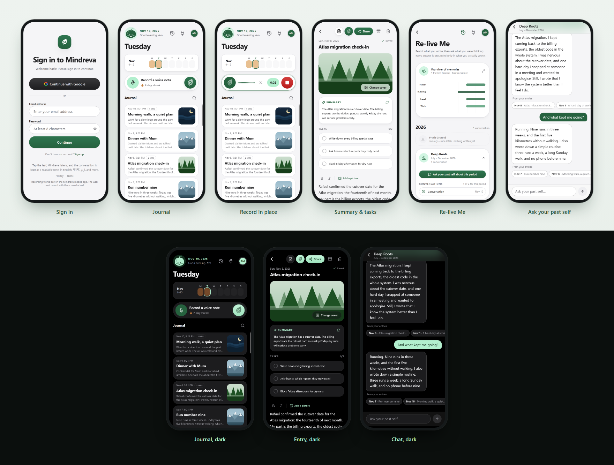
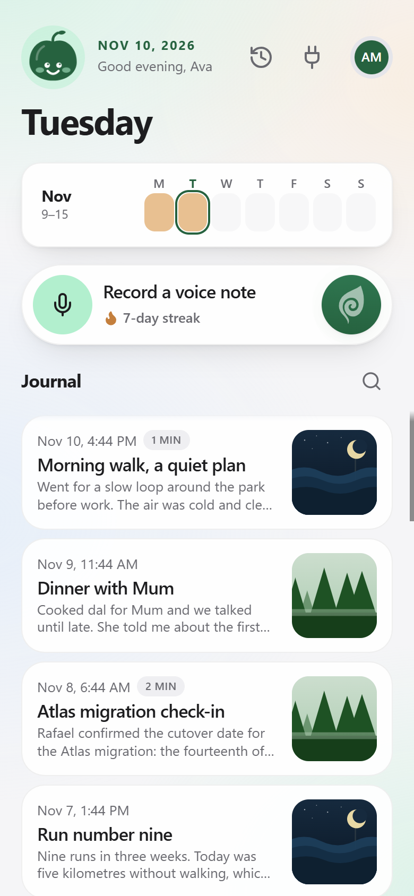
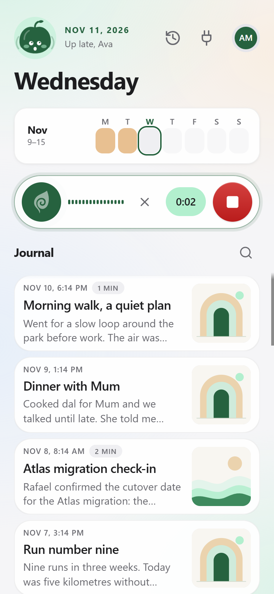
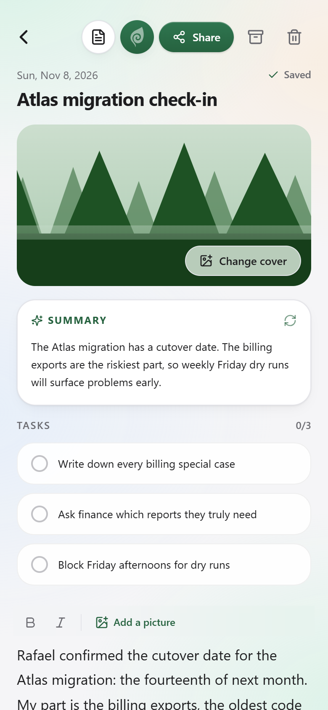
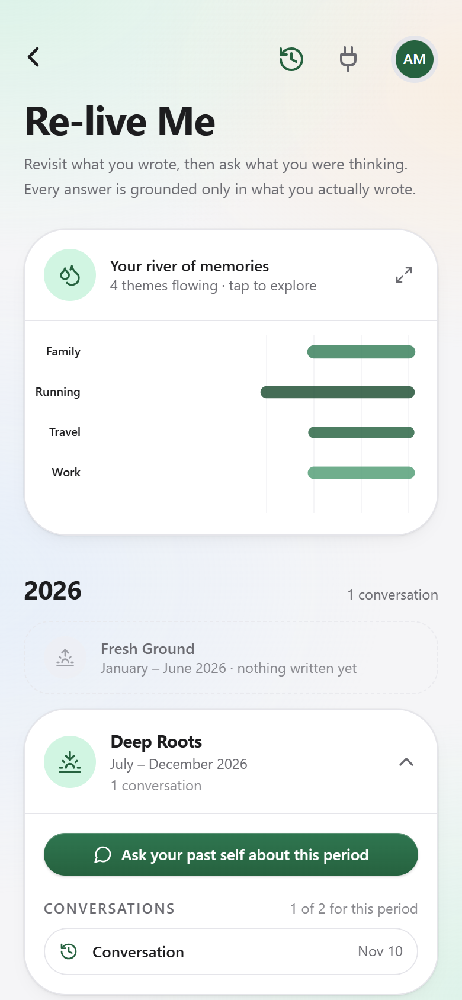
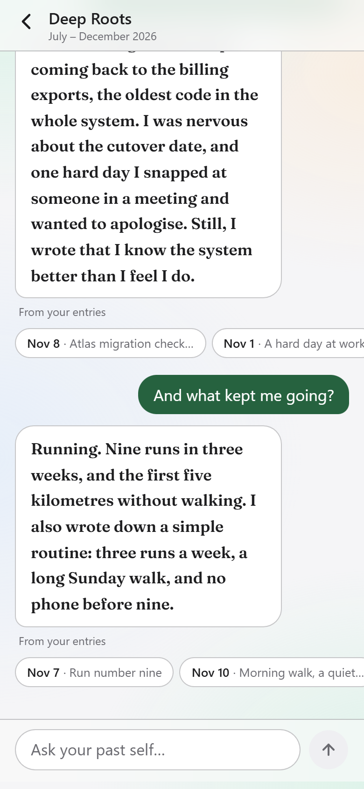
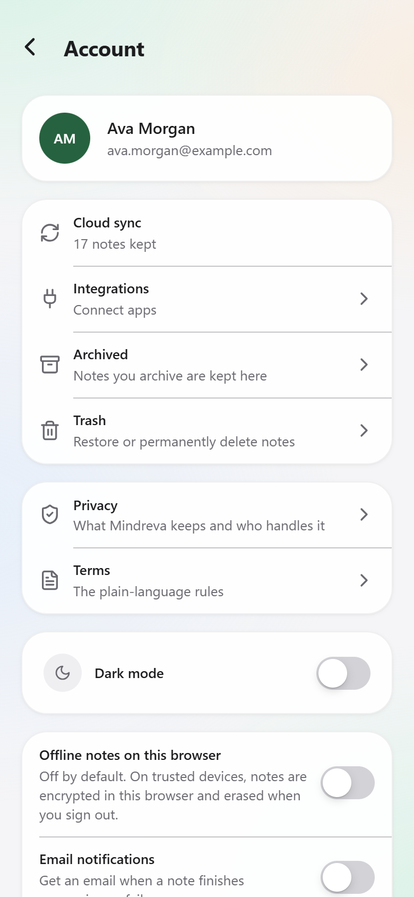
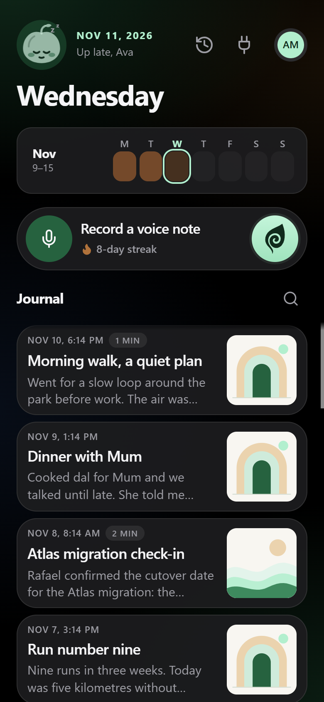
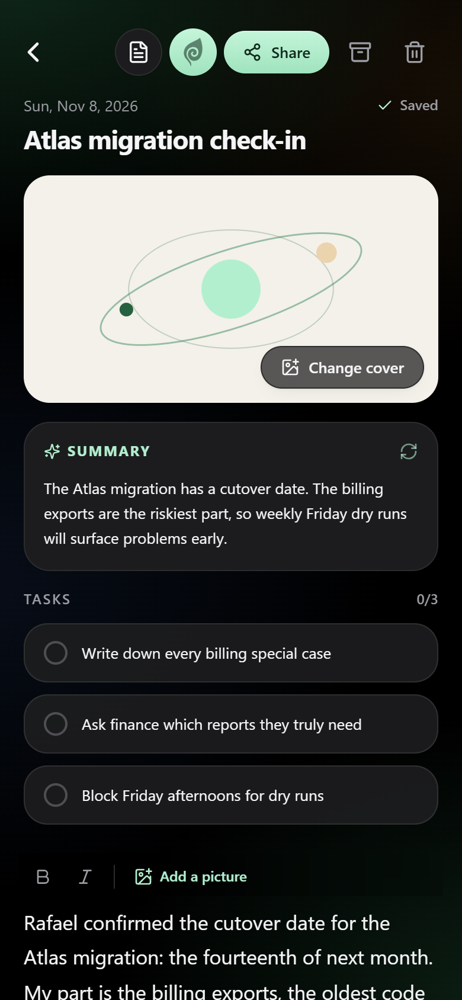
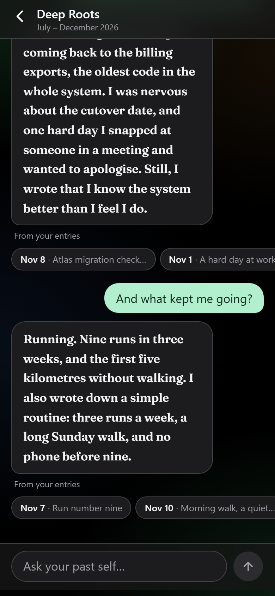

<div align="center">

# Mindreva

**A private, voice-first journal that remembers what you said, and lets you ask your past self about it.**

Talk, and it becomes a readable note with a title, a summary and a checklist. Months later, ask what you were thinking, and get an answer grounded only in what you actually wrote.

<br />



</div>

<br />

## What it does

|                                    |                                                                                                                                                                                                                                                                         |
| ---------------------------------- | ----------------------------------------------------------------------------------------------------------------------------------------------------------------------------------------------------------------------------------------------------------------------- |
| **Record in place**                | Tap the leaf on the Journal and start talking. There is no separate recording screen: pause, discard, and watch a live level meter, then stop. Your take is saved even if the microphone drops or you leave the screen.                                                 |
| **A readable note, automatically** | Each recording is transcribed (English, বাংলা and اردو among others), then given a title, a summary and a checklist of the real action items in it. You can edit the text, add pictures, and re-record more onto the same entry later.                                  |
| **Re-live Me**                     | Ask your past self a question about any half-year. Every answer is built only from entries that were retrieved for that question, comes with one tappable citation per entry, and says plainly when you never wrote about it. Replies stream in, and you can stop them. |
| **River of memories**              | Your themes, laid out along a real calendar: when a theme flowed, when it went quiet, and when it came back. All of it is computed from your own dates.                                                                                                                 |
| **Streaks and activity**           | A week strip and a streak that follow your own midnight, wherever you are.                                                                                                                                                                                              |
| **Yours**                          | Row Level Security on every table, soft delete with Archive and Trash, share an entry by link or with specific people, and delete your whole account and its files from the Account screen.                                                                             |
| **Free, and honest about limits**  | Nothing is behind a paywall. The optional "Support Mindreva" link is voluntary and unlocks nothing. Daily AI limits are explained calmly and never lose an entry.                                                                                                       |

Also: light and dark mode, an iOS-style interface built for phones (installable as a home-screen app), and an optional Google Calendar connection that shows the day an entry belongs to and adds events from your recordings with one tap.

## Screens

<table>
  <tr>
    <td align="center" width="33%"><br /><sub><b>Journal</b><br />Week strip, streak, record bar, entries</sub></td>
    <td align="center" width="33%"><br /><sub><b>Record in place</b><br />Live meter, pause, discard, stop</sub></td>
    <td align="center" width="33%"><br /><sub><b>Entry</b><br />Summary, tasks, editable text</sub></td>
  </tr>
  <tr>
    <td align="center"><br /><sub><b>Re-live Me</b><br />River of memories and your sessions</sub></td>
    <td align="center"><br /><sub><b>Ask your past self</b><br />Grounded answers with citations</sub></td>
    <td align="center"><br /><sub><b>Account</b><br />Archive, Trash, privacy, delete account</sub></td>
  </tr>
  <tr>
    <td align="center"><br /><sub><b>Journal, dark</b></sub></td>
    <td align="center"><br /><sub><b>Entry, dark</b></sub></td>
    <td align="center"><br /><sub><b>Chat, dark</b></sub></td>
  </tr>
</table>

<sub>All screenshots are of a demo account with made-up entries, captured from this repository's production build at 390 px.</sub>

## How it works

```text
  voice ──► MediaRecorder ──► Next.js route ──► Supabase Storage (private bucket)
                                   │
                                   ▼
                    ASR provider (Groq Whisper, Hugging Face fallback)
                                   │ transcript
                                   ▼
                    LLM provider ──► title · summary · tasks
                                   │
                                   ▼
              chunk the text (date-prefixed) ──► embeddings ──► pgvector
                                                              + Postgres full-text

  question ──► filter to the user and date range ──► vector + keyword search
           ──► fuse and rank ──► (no evidence? say so, no model call)
           ──► grounded answer, streamed, with one citation per entry
```

- **Honest by construction.** The date range and the user are filtered in SQL _before_ anything is ranked. If nothing relevant is found, Mindreva replies that you didn't write about it, without calling the model at all, so it has nothing to make up.
- **Search that survives change.** Entries are split into date-prefixed chunks and embedded once per real change (a content hash skips formatting-only edits). Vector search and full-text search are merged with reciprocal rank fusion. A retry queue means a failed or rate-limited embedding is never lost, and a save is never blocked by one.
- **Built for free-tier AI.** Completions try a list of models, then fall back to a second provider, with per-user daily limits so one person can't use up the shared quota. If a summary can't be written, the entry is saved and retried later.
- **Providers are swappable.** All speech-to-text goes through an `ASRProvider` interface and all language-model calls through `LLMProvider` (Gemini, Groq, Claude and OpenRouter are implemented); business logic never knows which one is active.

## Stack

- **App:** Next.js 15 (App Router), React 19, TypeScript, Tailwind CSS
- **Data:** Supabase (Postgres, Auth, Storage), Drizzle ORM, pgvector, row-level security
- **Monorepo:** Turborepo and pnpm workspaces
- **AI:** pluggable ASR and LLM providers (see above)
- **Quality:** Vitest, ESLint, Prettier, commitlint, GitHub Actions CI, Sentry
- **Deploy:** Vercel and Supabase

## Getting started

### Prerequisites

- Node.js 24 or later and pnpm 10
- A Supabase project (the free tier is enough)
- API keys for the speech-to-text and language-model providers you choose (Groq and OpenRouter both have free tiers)

### Install and configure

```bash
pnpm install
cp .env.example apps/web/.env.local        # PowerShell: Copy-Item .env.example apps/web/.env.local
```

Fill in `apps/web/.env.local` with your Supabase credentials and provider keys. [The Supabase setup guide](docs/supabase-setup.md) lists the required values and dashboard steps, and `.env.example` documents every variable. A few worth knowing:

| Variable                    | What it does                                                                                                                                 |
| --------------------------- | -------------------------------------------------------------------------------------------------------------------------------------------- |
| `NEXT_PUBLIC_SUPPORT_URL`   | A voluntary tip page (`https://` only). Shows a "Support Mindreva" row on Account and small footer links; empty hides both. Unlocks nothing. |
| `NEXT_PUBLIC_CONTACT_EMAIL` | Where privacy requests go; shown on the Privacy and Terms pages when set.                                                                    |
| `NEXT_PUBLIC_SITE_URL`      | The canonical origin for share previews, the sitemap and `robots.txt`.                                                                       |
| `CRON_SECRET`               | Unlocks the daily `/api/cron/embeddings` job that catches up embedding work. Without it the route refuses every request.                     |
| `RETRIEVAL_MIN_SIMILARITY`  | Overrides the past-self search's similarity threshold (default in `apps/web/lib/retrieval/retrieve.ts`).                                     |
| `SUPABASE_SERVICE_ROLE_KEY` | Server only. Needed for shared-entry pictures and for account deletion.                                                                      |

The server checks its environment at startup: in production it refuses to start without the core database and Supabase variables, and it logs which features are off for any provider key that is missing.

### Set up the database

```bash
pnpm --filter @mindreva/database db:migrate
```

If you already have entries, backfill their search data. This is a dry run by default (see the script header):

```bash
pnpm --filter @mindreva/database db:backfill-embeddings
```

### Run it

```bash
pnpm dev
```

Open [http://localhost:3000](http://localhost:3000) and create an account.

## Useful commands

```bash
pnpm dev          # develop
pnpm build        # production build
pnpm lint         # ESLint across the workspace
pnpm typecheck    # TypeScript across the workspace
pnpm test         # unit tests
pnpm format:check # Prettier

pnpm --filter @mindreva/database db:rls-check   # prove one user can't read another's rows
```

## Project layout

```text
apps/web            Next.js application (screens, API routes, services)
packages/asr        Speech-to-text provider interface and implementations
packages/auth       Supabase auth clients and middleware
packages/database   Drizzle schema, migrations and repositories
packages/llm        Chat, summary, embedding and streaming providers
packages/types      Shared domain types and utilities
packages/ui         Reusable UI components and design tokens
docs                Roadmap, decisions, setup notes, known issues, screenshots
```

A few rules the codebase holds itself to (details in [CLAUDE.md](CLAUDE.md)): Row Level Security is on for every table; only repositories touch Drizzle; entries are only ever soft-deleted (account deletion is the one deliberate exception); journals and notes share one `entries` table.

## Documentation

- [Roadmap](docs/roadmap.md)
- [Architecture decisions](docs/DECISIONS.md)
- [Known issues](docs/KNOWN-ISSUES.md)
- [Changelog](docs/CHANGELOG.md)
- [Supabase setup](docs/supabase-setup.md)

## Privacy

Journals are personal data. Mindreva scopes every database record to its owner with Row Level Security, serves private files through short-lived signed URLs, and sets a strict Content Security Policy and other security headers. Entry text and chat questions are sent to the configured AI providers to transcribe, summarise and search; the in-app Privacy page says exactly which. Keep service-role and AI-provider keys server-side and never expose them in browser code.
