# Mindreva Engineering Roadmap

**From first commit to production. A phase-by-phase blueprint built for Claude Code to execute.**

Last updated: July 23, 2026 (revised after founder-supplied reference screens, see changelog below). Free-tier numbers change often; treat every specific figure below as "verified this month," not a permanent guarantee, and recheck provider docs before you rely on a number for a business decision.

**Changelog, July 23 revision:** incorporated reference screens from a comparable app (working name in the references: "Magpie"). Added: onboarding (language preference + summary style selection), auto-titled entries, archive/trash, a settings/account screen, a real web-recording limitation to design around, and usage-quota schema groundwork. Primary color direction changed from "confident mid-tone mint" to **dark mint**. See the design reference note below.

---

## How to use this document

1. Work top to bottom. Each phase assumes the previous one is done.
2. Each phase is self-contained: objective, diagram, folder structure, checklist, time, priority, dependencies, mistakes, best practices, and a ready-to-paste Claude Code prompt.
3. Paste the "Claude Code prompt" block for a phase directly into Claude Code as your instruction. They reference the actual paths and decisions from this document, so Claude Code does not need extra context to start.
4. Do not skip the "Common mistakes" sections. In this app specifically, several of them are data-loss or trust-loss mistakes, not just inconvenience.
5. Treat Phase 0 as a decisions record, not a checklist. It exists so every later phase (and Claude Code) has the same shared context.
6. **Design reference:** save the founder-supplied reference screenshots into `docs/design-reference/` in the repo. Phase 2 onward tell Claude Code to look at these images directly for exact visual details (spacing, copy tone, component shapes) rather than relying on prose descriptions here. The text in this document describes _scope and structure_ (what screens exist, what they do, what data they need); the images are the source of truth for _how they look_.

---

## Phase Timeline at a Glance

| Phase | Name                                         | Priority | Est. Time                    | Depends on                        |
| ----- | -------------------------------------------- | -------- | ---------------------------- | --------------------------------- |
| 0     | Architecture decisions (this section)        | P0       | 0.5 day                      | None                              |
| 1     | Monorepo bootstrap & dev environment         | P0       | 1-2 days                     | Phase 0                           |
| 2     | Design system (Mint/White theme)             | P0       | 2-3 days                     | Phase 1                           |
| 3     | Database, Auth & backend foundations         | P0       | 3-5 days                     | Phase 1                           |
| 4     | Voice capture & ASR abstraction layer        | P0       | 4-6 days                     | Phase 3                           |
| 5     | Journaling, notes & summarization pipeline   | P0       | 4-6 days                     | Phase 4                           |
| 6     | "Chat with past self" RAG persona engine     | P1       | 5-7 days                     | Phase 5                           |
| 6.5   | Photo attachments for entries                | P2       | 1-2 days                     | Phase 5                           |
| 7     | CI/CD & free-tier deployment                 | P0       | 2-3 days                     | Phase 2 (can run parallel to 3-6) |
| 8     | PWA + Capacitor mobile wrapper -> Play Store | P1       | 5-8 days                     | Phase 7                           |
| 9     | Scaling, observability & migration playbook  | P2       | 1-2 days setup, then ongoing | Phase 7                           |

Solo founder, working with an AI pair programmer, realistic MVP (Phases 0-7 web app live): **4-6 weeks**. Add 1-2 weeks for the Play Store submission cycle in Phase 8.

---

## Phase 0: Architecture Decisions (ADRs)

**Objective:** lock in the decisions every later phase depends on, so you (and Claude Code) never re-litigate them mid-build.

### Tech stack at a glance

| Layer                  | Choice                                                                                                        | Why                                                                                                                                                                                                                                                                                                                                                                                                    | Free ceiling                                                                           | Escape hatch if you outgrow it                                                                |
| ---------------------- | ------------------------------------------------------------------------------------------------------------- | ------------------------------------------------------------------------------------------------------------------------------------------------------------------------------------------------------------------------------------------------------------------------------------------------------------------------------------------------------------------------------------------------------ | -------------------------------------------------------------------------------------- | --------------------------------------------------------------------------------------------- |
| Monorepo               | Turborepo + pnpm workspaces                                                                                   | Simpler than Nx for a solo team, built by Vercel so it deploys with zero extra config, great caching                                                                                                                                                                                                                                                                                                   | N/A (build tool, not hosted)                                                           | Nx migration is mechanical if you ever need its generators                                    |
| Frontend               | Next.js 15 (App Router) + TypeScript                                                                          | One codebase serves web now and becomes the Capacitor shell later                                                                                                                                                                                                                                                                                                                                      | Vercel Hobby limits (see Phase 7)                                                      | Any Node host (Railway, Fly.io, self-hosted)                                                  |
| Styling                | Tailwind CSS + shadcn/ui                                                                                      | Utility CSS maps cleanly to design tokens; shadcn gives you owned, editable component code instead of a black-box library. Primary brand color is **dark mint** (a deep, confident green, not the lighter/brighter mint used in the founder's reference screens), paired with a serif logotype for the wordmark and clean sans-serif for everything else, exactly as shown in `docs/design-reference/` | Free forever, no vendor                                                                | N/A, it's just code you own                                                                   |
| Database               | Postgres via Supabase                                                                                         | Bundles DB + Auth + Storage + pgvector in one free project; Supabase is open source and self-hostable, so it's a soft lock-in only                                                                                                                                                                                                                                                                     | 500MB DB, 1GB file storage, 50K MAU (verify current numbers)                           | Drizzle schema ports to any Postgres (Neon, RDS, self-hosted) with a connection-string change |
| ORM                    | Drizzle ORM                                                                                                   | Thinner than Prisma, faster cold starts on serverless, output is close to raw SQL so migrating providers is trivial                                                                                                                                                                                                                                                                                    | Free, no vendor                                                                        | It's just SQL-typed TypeScript; portable by design                                            |
| Auth                   | Supabase Auth                                                                                                 | Zero extra service, Postgres Row Level Security enforces per-user isolation at the DB layer, which matters enormously for a journaling app                                                                                                                                                                                                                                                             | Included in Supabase free tier                                                         | Auth.js/Clerk adapter behind the same `AuthProvider` interface if you outgrow it              |
| ASR (speech-to-text)   | Provider-abstracted. MVP default: Groq-hosted Whisper. Upgrade path: self-hosted Nemotron 3.5 ASR (ONNX, CPU) | See ADR-4 below                                                                                                                                                                                                                                                                                                                                                                                        | Groq free tier is real but modest (verify current daily quota)                         | Swap the `ASR_PROVIDER` env var, nothing else changes                                         |
| LLM (summaries + chat) | Provider-abstracted. MVP default: Gemini 2.5 Flash. Upgrade path: Claude API                                  | See ADR-5 below                                                                                                                                                                                                                                                                                                                                                                                        | Gemini free tier is the most generous permanent one available (verify current numbers) | Swap the `LLM_PROVIDER` env var                                                               |
| Embeddings             | Same provider abstraction, Gemini embeddings by default                                                       | Keeps RAG pipeline in the same free tier as summaries                                                                                                                                                                                                                                                                                                                                                  | Shares Gemini's free quota                                                             | Swap provider, same interface                                                                 |
| Object storage         | Supabase Storage for MVP, Cloudflare R2 later                                                                 | Fewer moving parts at MVP size; R2 has zero egress fees when audio volume grows                                                                                                                                                                                                                                                                                                                        | 1GB (Supabase free)                                                                    | Storage abstraction, see Phase 4                                                              |
| Hosting                | Vercel Hobby (free)                                                                                           | Fastest path to a live URL, native Next.js support                                                                                                                                                                                                                                                                                                                                                     | See ADR-7, this has a real ToS catch                                                   | Vercel Pro, or any Docker host, since Next.js is portable                                     |
| Mobile                 | Capacitor.js wrapping the same Next.js app                                                                    | You already plan "web first, then Play Store", Capacitor is built for exactly this, no second codebase                                                                                                                                                                                                                                                                                                 | Free, open source                                                                      | N/A                                                                                           |
| CI/CD                  | GitHub Actions                                                                                                | Generous free minutes, no separate account needed                                                                                                                                                                                                                                                                                                                                                      | Free for this scale                                                                    | N/A                                                                                           |
| Error tracking         | Sentry free tier                                                                                              | Best-known, generous free error tracking                                                                                                                                                                                                                                                                                                                                                               | Verify current event quota                                                             | N/A                                                                                           |

### ADR-1: Turborepo over Nx

Nx has more power (generators, richer dependency graph tooling) but more concepts to learn. For a solo founder shipping fast, Turborepo's simplicity and native Vercel integration wins. Revisit only if you add multiple backend services with complex build graphs.

### ADR-2: Supabase over separate Postgres + Auth + Storage vendors

Bundling saves real integration time at MVP stage. The "vendor lock-in" risk is softened because Supabase is open source Postgres underneath; you can `pg_dump` out or self-host the whole stack if you ever need to leave.

### ADR-3: Drizzle over Prisma

Prisma's query engine binary has historically added cold-start latency on serverless functions, which matters on Vercel's function-duration limits. Drizzle compiles to something closer to plain SQL and has smaller cold starts. Both are fine choices; Drizzle is the better fit for this specific hosting constraint.

### ADR-4: ASR strategy, the honest version

Your instinct on Nemotron 3.5 ASR is good, it is a real, very recent (2026) NVIDIA model: 600M parameters, 40 language-locales in one checkpoint, genuinely designed for streaming. But two things matter before treating it as your Day 1 dependency:

- NVIDIA's own guidance recommends GPU hardware for it, especially the multilingual checkpoint. The benchmarked, production-grade CPU story (RTFx above 6, sub-1GB after 4-bit quantization) comes from a separate Microsoft ONNX Runtime reimplementation, and that specific benchmarked work targeted the **English-only** sibling model.
- Community ONNX and CoreML exports of the full multilingual model exist, and early adopters report success running them on CPU and even in-browser via WebGPU. This is genuinely exciting and directly fits your "web first, then Capacitor" plan, since a model running in-browser also runs inside the Capacitor WebView with zero extra work. But it is weeks old, not a mature SDK, and a ~700MB+ model download is a real UX cost on mobile.

**Decision:** build the `ASRProvider` interface first (Phase 4). Ship MVP on a hosted free-tier provider (Groq's hosted Whisper, or Hugging Face Inference as backup) so you have zero infrastructure to manage while you validate the product. Once you have real usage and a reason to cut per-request costs or support offline mode, add the self-hosted Nemotron adapter, starting with the English ONNX build if your users are mostly English speakers (proven, benchmarked path), or the multilingual community ONNX build if you need global coverage from day one (accept more testing risk). The in-browser WebGPU path is a legitimate stretch goal for later, not an MVP requirement.

### ADR-5: LLM strategy

Anthropic's Claude API has no standing free tier (occasional expiring trial credits only), so it is not the right MVP default for a "free-first" build, however good the output quality. Google's Gemini API currently has the most generous permanent free tier among frontier-adjacent models and explicitly allows commercial use. Use Gemini 2.5 Flash as the default `LLMProvider` for summarization and the past-self chat. Keep Groq as a fast, free fallback for latency-sensitive paths. Add Claude (Sonnet 5 for quality, Haiku 4.5 for cheap high-volume calls) as a selectable premium provider once you monetize; Claude's careful, non-presumptuous writing style is a genuinely good fit for the emotionally sensitive past-self persona feature specifically.

### ADR-6: Capacitor over React Native

You already stated the plan: webapp first, then a Play Store version. Capacitor wraps your existing Next.js build in a native shell and gives you native APIs (microphone, filesystem, notifications) without a second codebase or rewrite. React Native would require rebuilding the UI layer twice. Capacitor is the only choice that matches your stated sequencing.

### ADR-7: Vercel Hobby, with a catch you need to know now

Vercel's Hobby plan is free but its Terms of Service restrict it to **personal, non-commercial use**. The moment Mindreva takes payments, runs ads, or otherwise generates revenue, you are expected to be on Pro (around $20/month). Build on Hobby through MVP and validation. Budget the Pro upgrade as a day-one line item the moment you flip on monetization, not as a "when we hit a usage wall" decision. Separately, Hobby's serverless function timeout (commonly cited around 10 seconds, verify current docs) is a hard architectural constraint: any ASR or LLM call that might run long must be async (job created, processed, polled or subscribed to), never a synchronous request-response inside one function call.

### System architecture (overview)

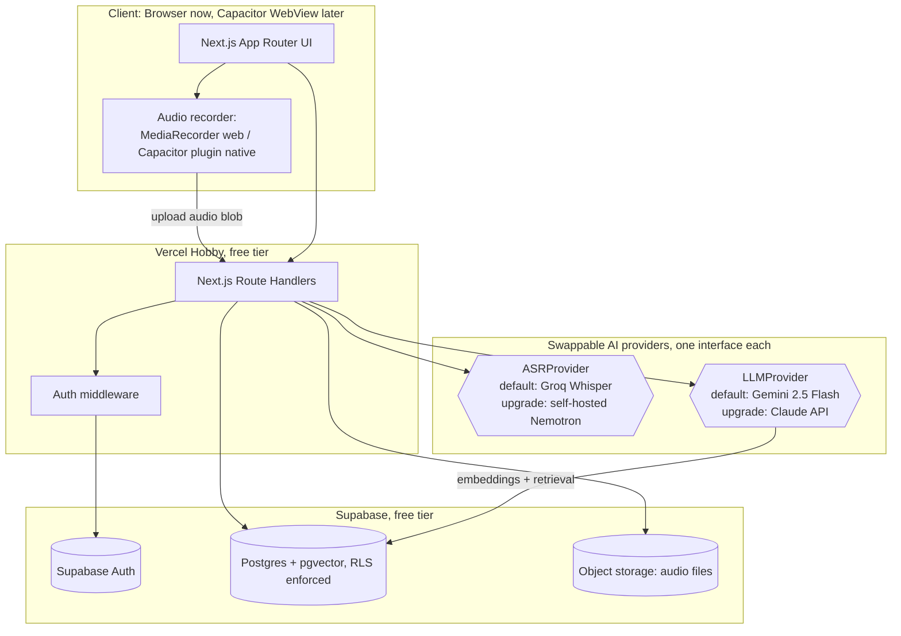

### Master monorepo folder structure

This is the target shape by the end of Phase 3. Later phases only show what each phase _adds_.

```
mindreva/
├── apps/
│   ├── web/                      # Next.js app: the entire product, later wrapped by Capacitor
│   │   ├── app/                  # App Router pages and route handlers
│   │   ├── components/           # App-specific components (not shared design system)
│   │   ├── lib/                  # App-specific glue code
│   │   ├── public/
│   │   └── next.config.ts
│   └── inference/                 # Optional standalone ASR microservice (added in Phase 4/9 if self-hosting)
├── packages/
│   ├── ui/                        # Shared design system (Phase 2)
│   ├── database/                  # Drizzle schema, migrations, client (Phase 3)
│   ├── auth/                      # Auth helpers wrapping Supabase Auth (Phase 3)
│   ├── asr/                       # ASRProvider interface + adapters (Phase 4)
│   ├── llm/                       # LLMProvider interface + adapters (Phase 5)
│   ├── types/                     # Shared TS types and zod schemas
│   └── config/                    # Shared eslint, tsconfig, tailwind config
├── docs/
│   ├── roadmap.md                 # this document
│   └── design-reference/          # founder-supplied reference screenshots, see Phase 2
├── .github/
│   └── workflows/                 # CI pipelines (Phase 7)
├── turbo.json
├── pnpm-workspace.yaml
├── package.json
└── .env.example
```

---

## Phase 1: Monorepo Bootstrap & Dev Environment

**Objective:** a working, empty, fully-tooled monorepo that builds, lints, and deploys before a single feature is written. This is the "boring infrastructure" phase; nothing here should be visible to a user yet.

**Priority:** P0 (blocking everything else)
**Estimated time:** 1-2 days
**Dependencies:** Phase 0 decisions

### Architecture diagram

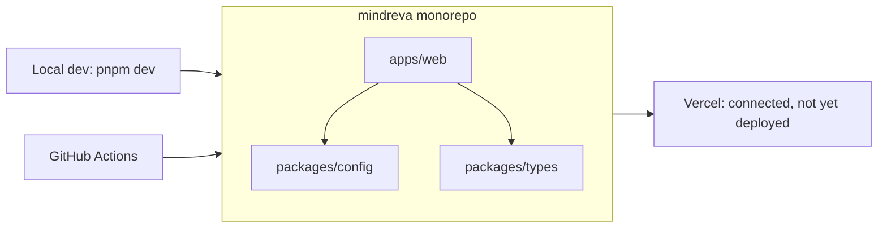

### Folder structure added this phase

```
mindreva/
├── apps/web/                # next.js app, default starter page only
├── packages/config/         # shared eslint-config, tsconfig, tailwind-config
├── packages/types/          # empty package, ready for Phase 3
├── .nvmrc
├── .env.example
├── .gitignore
├── turbo.json
├── pnpm-workspace.yaml
└── package.json
```

### Task checklist

- [ ] Create GitHub repo (private), add `.gitignore` (node_modules, .env\*, .next, .turbo)
- [ ] Create `docs/roadmap.md` (this document) and `docs/design-reference/` (drop your reference screenshots in here) so Claude Code can consult both throughout the build
- [ ] Add a `CLAUDE.md` at the repo root pointing Claude Code at `docs/roadmap.md` and noting which phase is currently in progress
- [ ] Install pnpm, pin Node version via `.nvmrc` (use current Node LTS)
- [ ] Initialize pnpm workspace (`pnpm-workspace.yaml` listing `apps/*` and `packages/*`)
- [ ] Install and configure Turborepo (`turbo.json` with `build`, `dev`, `lint`, `test` pipelines)
- [ ] Scaffold `apps/web` with `create-next-app` (TypeScript, App Router, Tailwind, no `src/` directory needed for a monorepo)
- [ ] Create `packages/config` with shared `eslint-config`, `tsconfig.base.json`, `tailwind-config`
- [ ] Create empty `packages/types` package, wire up TS path aliases (`@mindreva/types`, `@mindreva/config`)
- [ ] Set up Prettier + ESLint at the root, extended by each app/package
- [ ] Set up Husky + lint-staged (pre-commit: lint + format changed files)
- [ ] Set up commitlint (conventional commits) so history stays readable
- [ ] Write `.env.example` with every env var you already know you'll need, even if unused yet
- [ ] Connect the repo to Vercel, confirm a default deploy succeeds (empty starter page live at a `*.vercel.app` URL)
- [ ] Add branch protection on `main` (require PR, require passing checks) once Phase 7's CI exists; note it here so you remember to do it

### Common mistakes

- Committing `node_modules`, `.env`, or `.next` because `.gitignore` wasn't set up before the first commit. Fix the `.gitignore` before running any install.
- Skipping TypeScript path aliases at this stage. Retrofitting `@mindreva/ui` style imports across a growing codebase later is pure busywork that Phase 1 avoids for free.
- Choosing Nx "just in case" because it looks more serious. It adds real conceptual overhead you do not need yet; you explicitly said not to over-complicate this.
- Not pinning the Node version. "Works on my machine" bugs during later phases usually trace back to this.

### Best practices

- Use pnpm specifically; its content-addressable store and native workspace protocol (`workspace:*`) are the least painful monorepo experience for a solo dev.
- Get a green CI check (even a trivial one) merged before writing any feature code, so the habit is established from commit one.
- Keep `packages/config` as the single source of truth for lint/format/TS rules; every app and package extends it, never redefines it.
- Treat `.env.example` as living documentation. Add a line the moment you know you'll need a var, even before you use it.

### Claude Code prompt for this phase

```
Set up a new Turborepo monorepo called "mindreva" using pnpm workspaces.

Structure:
- apps/web: a Next.js 15 app (App Router, TypeScript, Tailwind CSS, no src/ directory)
- packages/config: shared eslint config, a base tsconfig.json, and a shared tailwind.config
- packages/types: an empty TypeScript package for shared types, wired up but with no content yet

Requirements:
- Root turbo.json with pipelines for build, dev, lint, and test
- pnpm-workspace.yaml listing apps/* and packages/*
- TypeScript path aliases so apps/web can import "@mindreva/config" and "@mindreva/types"
- Root .eslintrc and .prettierrc that apps/web extends from packages/config
- Husky + lint-staged pre-commit hook that runs lint and format on staged files
- commitlint configured for conventional commits
- A .nvmrc pinning the current Node LTS version
- A thorough .env.example file with placeholder entries for: DATABASE_URL, SUPABASE_URL, SUPABASE_ANON_KEY, SUPABASE_SERVICE_ROLE_KEY, ASR_PROVIDER, GROQ_API_KEY, HUGGINGFACE_API_KEY, LLM_PROVIDER, GEMINI_API_KEY, ANTHROPIC_API_KEY (each with a one-line comment explaining what it's for)
- A proper .gitignore covering node_modules, .env*, .next, .turbo, dist

After scaffolding, run the build and lint pipelines to confirm everything is wired up correctly, and report any errors.
```

---

## Phase 2: Design System (Mint / White Theme)

**Objective:** a shared, tokenized component library that gives every future screen a consistent, premium, minimal look without redefining styles per-screen.

**Priority:** P0
**Estimated time:** 2-3 days
**Dependencies:** Phase 1

### Architecture diagram

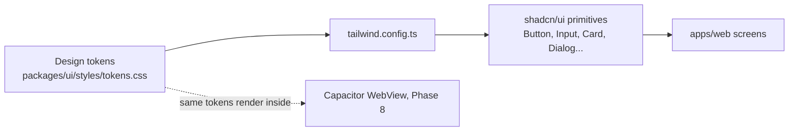

### Design reference

Founder-supplied reference screens live in `docs/design-reference/` (sign-in, language/use-case onboarding, journal list, date picker, recording, account/settings). The overall structure, copy tone, and component shapes in those images are the target; the one deliberate change is **dark mint** instead of the lighter/brighter green shown there. Have Claude Code view the images directly rather than working from a text description of them.

Two typography and color notes worth locking in now, both visible across every reference screen:

- **Serif logotype, sans-serif everything else.** The wordmark uses a bold serif face; all UI text (labels, body, buttons) is a clean sans-serif. That contrast is doing real work for the "premium, personal" feel, keep it.
- **Dark mint as the confident primary**, with a much lighter mint tint reserved for selected/active backgrounds (the light green fill behind a selected list row in the reference screens), not for primary buttons or body text.

### Folder structure added this phase

```
packages/ui/
├── src/
│   ├── styles/
│   │   ├── tokens.css        # dark mint scale, neutral scale, semantic colors, spacing, radii, shadows
│   │   └── globals.css
│   ├── components/
│   │   ├── button.tsx
│   │   ├── input.tsx
│   │   ├── textarea.tsx
│   │   ├── card.tsx
│   │   ├── avatar.tsx                  # circular, shows initials when no photo, as in the account screen
│   │   ├── dialog.tsx
│   │   ├── bottom-sheet.tsx            # the date-picker modal pattern from the reference
│   │   ├── tabs.tsx
│   │   ├── badge.tsx
│   │   ├── skeleton.tsx
│   │   ├── toast.tsx
│   │   ├── progress-bar.tsx            # the "1m of 1h" / "2 of 10" usage bars on the account screen
│   │   ├── settings-row.tsx            # label + description + trailing toggle/chevron, used repeatedly on account screen
│   │   ├── filter-pills.tsx            # the All / Today / This week / Date segmented control
│   │   ├── calendar-picker.tsx         # month grid with a dot under dates that have an entry
│   │   ├── note-card.tsx               # journal/note list item: title, date + duration, snippet
│   │   ├── record-button.tsx           # app-specific, not generic shadcn
│   │   └── waveform-visualizer.tsx     # app-specific
│   └── index.ts
├── tailwind.config.ts
└── package.json
```

### Task checklist

- [ ] Define CSS custom properties: **dark mint** scale (50-900, a deep confident primary, with only the lightest tint used for selected-row backgrounds), warm neutral/gray scale, semantic tokens (success/warning/danger/info), spacing scale, radius scale, two shadow levels
- [ ] Wire tokens into a shared `tailwind.config.ts` extended by `packages/config` and `apps/web`
- [ ] Load a serif font for the logotype/wordmark and a clean sans-serif for everything else via `next/font` (Geist for sans pairs naturally with the Vercel deployment target; Inter is the safe fallback) to avoid layout shift
- [ ] Install shadcn/ui inside `packages/ui`, theme it with the tokens above
- [ ] Build base components: Button (primary/secondary/ghost/destructive), Input, Textarea, Card, Avatar (initials fallback), Dialog, BottomSheet, Tabs, Badge, Skeleton, Toast, ProgressBar, SettingsRow
- [ ] Build the list/filtering components seen in the reference: `FilterPills` (All/Today/This week/Date segmented control) and `CalendarPicker` (month grid, dot indicator under dates that have an entry, Clear/Today actions)
- [ ] Build `NoteCard` (title, date + duration metadata, truncated snippet) for the journal/notes list
- [ ] Build two recording-specific components: `RecordButton` (idle/preparing-mic/recording/paused/processing states, see Phase 4 for the "preparing microphone" state) and `WaveformVisualizer` (simple SVG or canvas bar animation)
- [ ] Check dark mint against white for WCAG AA text contrast at every weight it's used (body text, button text, icons); adjust the shade if it fails
- [ ] Build a placeholder landing page (`apps/web/app/page.tsx`, unauthenticated route): logo, tagline, a single call-to-action into sign-up. Keep it simple, this is explicitly a placeholder to be redesigned visually later once you can see it live, not a finished marketing page
- [ ] Build a `/dev/components` page rendering every component and variant for visual QA (gate or remove before shipping)
- [ ] Write a short README in `packages/ui` documenting token names

### Common mistakes

- Hardcoding hex codes inside components instead of referencing tokens. This turns a future rebrand or dark mode into a full rewrite instead of a one-line token change.
- Using the same dark mint shade for both primary buttons and selected-row backgrounds. The reference distinguishes these: a light mint tint for "this is selected," a dark mint fill for "this is an action." Collapsing them into one shade makes the UI harder to scan.
- Failing WCAG AA contrast with the darker mint against white for small text. Check contrast before building real screens on top of the palette.
- Over-building the component library before you know which screens need what. Add components on demand from Phases 3-6, don't pre-build a full kit beyond what's listed above.
- Treating the RecordButton as a generic button. Voice capture is the core interaction of this entire app; it deserves its own dedicated states and polish now, not a bolt-on later.
- Spending real time polishing the placeholder landing page. It's explicitly a placeholder; move on once it exists.

### Best practices

- Keep every token in one CSS file so changing the brand color is a one-line diff.
- Use shadcn/ui's copy-into-repo model, not an installed dependency, so you fully own and can restyle every component.
- Design the loading/processing state pattern here, including the "preparing microphone" interim state, since transcription and summarization (Phases 4-5) are the two slowest interactions in the app and need a consistent, calm "working on it" pattern established early.
- Test the palette on an actual phone screen in daylight, not just your dev monitor. Dark mint reads differently under different screen brightness than it does in a design tool.
- Have Claude Code look at the actual reference screenshots in `docs/design-reference/` while building this phase, rather than working only from the checklist text.

### Claude Code prompt for this phase

```
In the mindreva monorepo (Turborepo + pnpm, apps/web is Next.js 15), create packages/ui as a shared design system package.

Theme: dark mint, white, clean, minimal, premium. Look at the reference screenshots in docs/design-reference/ for the overall structure, spacing, and copy tone; the one deliberate difference from those references is a darker, more confident mint instead of the lighter green shown there.

1. Define CSS custom properties in packages/ui/src/styles/tokens.css:
   - A dark mint color scale (50 through 900): a deep, confident primary tone, with only the lightest tint (50/100) used for selected-row backgrounds, never for primary buttons or body text.
   - A warm neutral/gray scale for text and backgrounds.
   - Semantic tokens: success, warning, danger, info.
   - A spacing scale, a border-radius scale, and two shadow levels (subtle, elevated).
2. Wire these tokens into a shared tailwind.config.ts that packages/config and apps/web both extend.
3. Load a serif font for the logo/wordmark and the Geist sans font (fallback Inter) for all other UI text, both via next/font.
4. Install and initialize shadcn/ui inside packages/ui, themed with the tokens above. Build: Button (primary/secondary/ghost/destructive variants), Input, Textarea, Card, Avatar (falls back to initials when there's no photo), Dialog, BottomSheet, Tabs, Badge, Skeleton, Toast, ProgressBar (labeled usage bar like "1m of 1h"), SettingsRow (label, description, trailing toggle or chevron).
5. Build FilterPills (a segmented control: All / Today / This week / Date) and CalendarPicker (month grid, a small dot under any date that has an entry, Clear and Today actions), matching the date-picker reference screen.
6. Build NoteCard: a list item showing a title, "date · duration" metadata line, and a truncated snippet, matching the journal list reference screen.
7. Build RecordButton with idle, preparing-mic, recording, paused, and processing visual states, and a simple WaveformVisualizer (SVG or canvas bar animation reacting to audio amplitude), matching the recording screen reference.
8. Build a simple placeholder landing page at apps/web/app/page.tsx: logo, tagline, one call-to-action into sign-up. Explicitly a placeholder, don't over-invest here.
9. Create a /dev/components page in apps/web rendering every component and variant in one place for visual QA, gated so it's easy to remove before production.
10. Check the dark mint shade against white for WCAG AA text contrast; if it fails, adjust the shade and report the change you made.

Keep everything in packages/ui. apps/web should only ever import from '@mindreva/ui', never redefine styles locally.
```

---

## Phase 3: Database, Auth & Backend Foundations

**Objective:** a Supabase-backed Postgres schema covering the entire product (journals, notes, recordings, transcripts, summaries, embeddings, chat), with Row Level Security enforced from the start and a clean repository/service layering so business logic never touches the ORM directly.

**Priority:** P0
**Estimated time:** 3-5 days
**Dependencies:** Phase 1 (Phase 2 can run in parallel)

### Architecture diagrams

Data model:

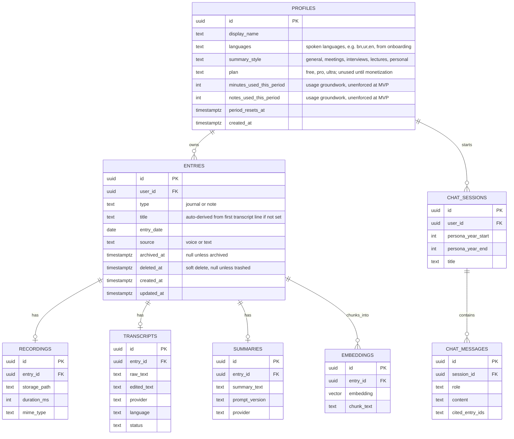

Layering (clean architecture / dependency inversion in practice):

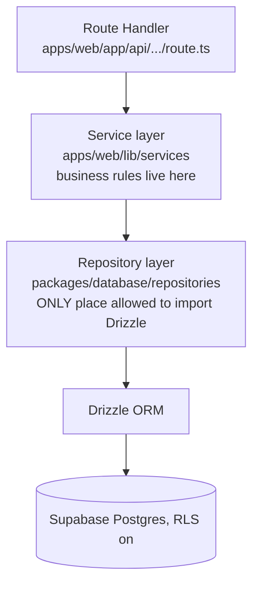

### Folder structure added this phase

```
packages/database/
├── src/
│   ├── schema.ts              # all tables, Drizzle schema definitions
│   ├── client.ts               # Drizzle client instance
│   ├── migrations/             # generated SQL migrations, includes RLS policies
│   └── repositories/
│       ├── entries.repository.ts
│       ├── recordings.repository.ts
│       ├── transcripts.repository.ts
│       ├── summaries.repository.ts
│       ├── embeddings.repository.ts
│       └── chat.repository.ts
├── drizzle.config.ts
└── package.json

packages/auth/
├── src/
│   ├── server.ts               # server-side Supabase auth helpers
│   ├── client.ts                # client-side Supabase auth helpers
│   └── middleware.ts            # session refresh + route protection
└── package.json

apps/web/
├── middleware.ts                # imports packages/auth middleware
├── lib/services/                # thin service layer, calls repositories
│   ├── entries.service.ts
│   ├── profile.service.ts       # onboarding preferences, settings updates
│   └── chat.service.ts
└── app/
    ├── (auth)/                  # sign-in, sign-up routes
    ├── (onboarding)/
    │   ├── languages/page.tsx   # "Which languages do you speak?"
    │   └── use-case/page.tsx    # "What will you use Mindreva for?" (sets summary_style)
    └── (protected)/account/page.tsx  # settings screen scaffold, grows in Phases 5 and 9
```

### Task checklist

- [ ] Create a Supabase project (free tier); store project URL, anon key, and service role key in `.env` (never commit them)
- [ ] Install Drizzle ORM + drizzle-kit, point it at the Supabase Postgres connection string
- [ ] Define the schema above in `packages/database/src/schema.ts`, including the `pgvector` extension and a `vector(768)` column on `embeddings`
- [ ] Generate and run the first migration
- [ ] Enable Row Level Security on every table; write policies so a user can only read/write rows tied to their own `user_id` (directly, or via a join for child tables like `recordings`/`transcripts`)
- [ ] Write a small RLS test (script or SQL) that attempts to read another user's row and confirms the database denies it
- [ ] Set up Supabase Auth: email/password plus one OAuth provider (Google is the easiest first one). Match the sign-in screen layout in `docs/design-reference/` (Google button, divider, email field, primary button); it's still Supabase Auth under the hood, only the visual flow is copied
- [ ] Build sign up, sign in, sign out UI using `packages/ui` components
- [ ] Build the two onboarding screens right after first sign-up: language preference (multi-select, stored as `profiles.languages`) and use-case/summary-style selection (single-select from general/meetings/interviews/lectures/personal, stored as `profiles.summary_style`). Both are skippable defaults (English + general) so onboarding never blocks someone from getting in
- [ ] Build the account/settings screen scaffold at `app/(protected)/account`: avatar with initials fallback, display name, email, plan badge (always "Free" for now), a sign-out action, and Privacy/Terms/Support links. Leave the archive/trash rows (Phase 5) and usage bars (Phase 9) as clearly marked TODOs in this phase, they get wired up when the data behind them exists
- [ ] Build Next.js middleware that protects authenticated routes and refreshes sessions automatically
- [ ] Build the repository layer (`packages/database/src/repositories`), one module per aggregate, as the only code allowed to import the Drizzle client
- [ ] Build a thin service layer in `apps/web/lib/services` that calls repositories and holds business rules; route handlers call services, never repositories directly
- [ ] Add indexes: `entries(user_id, created_at)`, `entries(user_id, entry_date)`, and an HNSW index on `embeddings.embedding`
- [ ] Add a GitHub Actions scheduled workflow that pings the Supabase project every few days to prevent free-tier auto-pause from inactivity

### Common mistakes

- Skipping RLS "for now, add it before launch." For a journaling app this is the single highest-stakes mistake in this entire roadmap: one missing policy means one user can read another user's private journal entries. Enable RLS before writing a single feature endpoint, not after.
- Calling Drizzle directly from a route handler "just this once." Every bypass of the repository layer is a future refactor, and a place a missing RLS assumption can hide unnoticed.
- Not indexing `user_id` and `created_at` on `entries`. Invisible at 10 rows, painfully slow at 10,000.
- Letting the free Supabase project pause silently from the 7-day inactivity rule, then discovering it mid-demo. Set the keep-alive workflow up in this phase.
- Storing transcript and summary rows without a `status` field. Without pending/processing/done/failed tracking you cannot build a sane retry or "still working on it" UI in Phases 4-5.
- Skipping the `plan`/usage-counter columns on `profiles` because monetization feels far away. Adding empty, unenforced columns now costs nothing; adding them after you have real user rows means a migration and a backfill decision. Add them now, wire up the enforcement later (Phase 9).

### Best practices

- Write RLS policies as SQL inside version-controlled migrations, never as one-off edits made only in the Supabase dashboard.
- Enforce "only repositories import Drizzle" with an ESLint import restriction if you want teeth on the rule, not just discipline.
- Model `entries` as one shared table for both journals and notes with a `type` discriminator, since the record-to-transcript-to-summary pipeline is identical for both, exactly as you described the product. Don't build two parallel systems for what is architecturally the same flow.
- Keep `prompt_version` and `provider` on every AI-generated row (summaries, transcripts). You will want to know which rows used an older prompt the first time you improve one.

### Claude Code prompt for this phase

```
Continuing in the mindreva monorepo. Set up the backend foundation.

1. Create packages/database as a new workspace package. Configure Drizzle ORM connected via a DATABASE_URL environment variable pointing at a Supabase Postgres instance. Use drizzle-kit for migrations.

2. Define this schema in packages/database/src/schema.ts:
   - profiles (id uuid PK referencing auth.users, display_name text, languages text, summary_style text default 'general', plan text default 'free', minutes_used_this_period integer default 0, notes_used_this_period integer default 0, period_resets_at timestamptz, created_at timestamptz). The languages column stores the user's onboarding language selection (simple comma-separated text is fine for MVP, no need for a separate join table). The plan/usage columns exist now but are not enforced anywhere yet, that comes in a later phase.
   - entries (id uuid PK, user_id uuid FK -> profiles.id, type text check in ('journal','note'), title text, entry_date date, source text check in ('voice','text'), archived_at timestamptz, deleted_at timestamptz, created_at, updated_at)
   - recordings (id uuid PK, entry_id uuid FK -> entries.id, storage_path text, duration_ms integer, mime_type text, created_at)
   - transcripts (id uuid PK, entry_id uuid FK -> entries.id, raw_text text, edited_text text, provider text, language text, status text check in ('pending','processing','done','failed'), created_at)
   - summaries (id uuid PK, entry_id uuid FK -> entries.id, summary_text text, prompt_version text, provider text, created_at)
   - embeddings (id uuid PK, entry_id uuid FK -> entries.id, chunk_text text, embedding vector(768), created_at). Enable the pgvector extension and add an HNSW index on embedding.
   - chat_sessions (id uuid PK, user_id uuid FK -> profiles.id, persona_year_start integer, persona_year_end integer, title text, created_at)
   - chat_messages (id uuid PK, session_id uuid FK -> chat_sessions.id, role text check in ('user','assistant'), content text, cited_entry_ids text, created_at)

   Add indexes on entries(user_id, created_at) and entries(user_id, entry_date).

3. Generate the migration and write Row Level Security policies for every table so a user can only select/insert/update/delete rows tied to their own user_id (directly, or via a join through entries for child tables). Write these as SQL inside the migration files, not only in the Supabase dashboard.

4. Build packages/database/src/repositories with one module per aggregate: EntriesRepository, RecordingsRepository, TranscriptsRepository, SummariesRepository, EmbeddingsRepository, ChatRepository. These must be the only files that import the Drizzle client directly. Add an ESLint rule restricting Drizzle imports to this directory.

5. Set up Supabase Auth in apps/web: email/password sign up and sign in, Google OAuth, sign out, and Next.js middleware that protects any route under app/(protected) and refreshes the session automatically. Build the sign-in/sign-up UI using components from packages/ui, matching the layout in docs/design-reference/ (Google button, "or" divider, email field, primary button below it).

6. Build two onboarding screens shown right after first sign-up, at app/(onboarding)/languages and app/(onboarding)/use-case, matching docs/design-reference/: a multi-select list of languages (store as profiles.languages) and a single-select list of use cases (general / meetings & standups / interviews & research / lectures & classes / personal voice notes, store as profiles.summary_style). Both need a sensible default (English, general) so a user can skip onboarding entirely.

7. Build an account/settings screen scaffold at app/(protected)/account/page.tsx: avatar with initials fallback, display name, email, a "Free" plan badge, sign out, and Privacy/Terms/Support footer links, matching docs/design-reference/. Leave clearly marked TODO comments for archive/trash rows (built in Phase 5) and usage progress bars (built in Phase 9), don't build those yet.

8. Build a thin service layer in apps/web/lib/services (entries.service.ts, profile.service.ts, chat.service.ts) that calls repositories and holds business rules. Route handlers should call services, never repositories directly.

9. Add a GitHub Actions workflow that pings the Supabase project on a schedule (every 3 days) to prevent free-tier auto-pause from inactivity.

Do not let any code outside packages/database/src/repositories import Drizzle directly.
```

---

## Phase 4: Voice Capture & ASR Abstraction Layer

**Objective:** the recording experience itself, and a genuinely swappable `ASRProvider` interface with a working, free, default implementation. This is the phase your Option 1 / 2 / 3 research directly informs.

**Priority:** P0
**Estimated time:** 4-6 days
**Dependencies:** Phase 3

### Architecture diagram

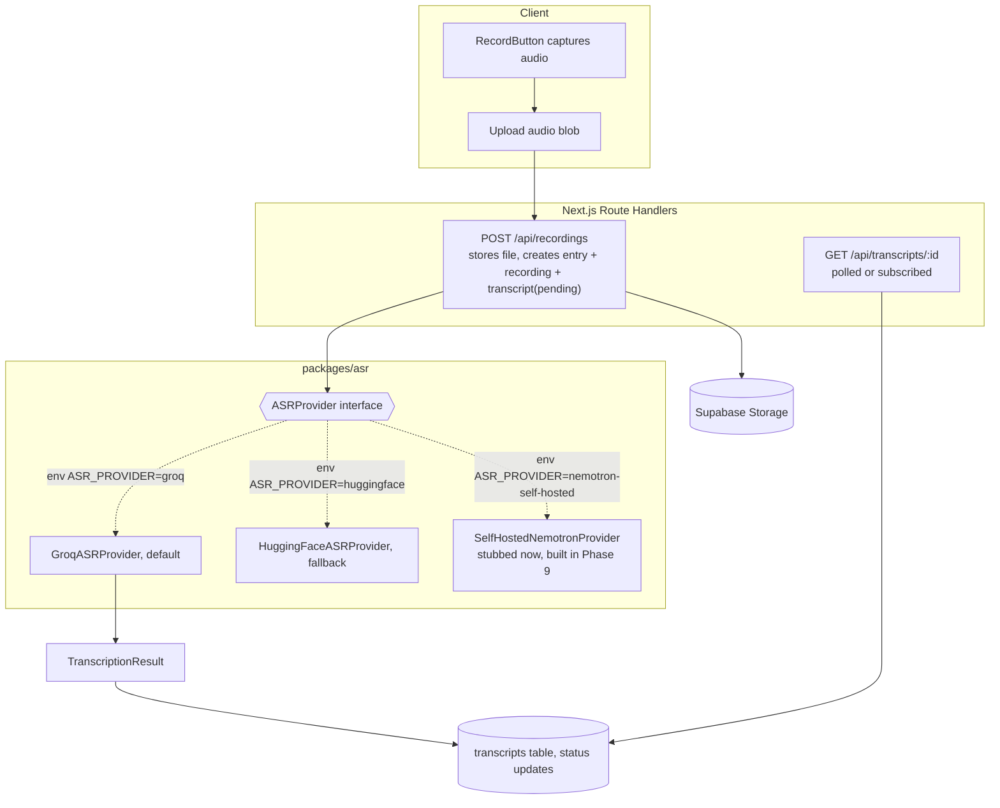

### The interface (this is the actual architecture, not just a diagram)

```typescript
// packages/asr/src/types.ts
export type ASRProviderName =
  "groq" | "huggingface" | "openai" | "elevenlabs" | "nemotron-self-hosted";

export interface TranscriptSegment {
  text: string;
  startMs: number;
  endMs: number;
}

export interface TranscriptionResult {
  text: string;
  language: string | null;
  durationMs: number;
  segments: TranscriptSegment[];
  provider: ASRProviderName;
}

export interface TranscribeOptions {
  languageHint?: string;
  prompt?: string;
}

export interface ASRProvider {
  readonly name: ASRProviderName;
  transcribe(
    audio: Buffer,
    mimeType: string,
    options?: TranscribeOptions,
  ): Promise<TranscriptionResult>;
}
```

```typescript
// packages/asr/src/factory.ts
import type { ASRProvider } from "./types";
import { GroqASRProvider } from "./providers/groq-provider";
import { HuggingFaceASRProvider } from "./providers/huggingface-provider";
import { SelfHostedNemotronProvider } from "./providers/self-hosted-provider";

export function getASRProvider(): ASRProvider {
  const provider = process.env.ASR_PROVIDER ?? "groq";
  switch (provider) {
    case "huggingface":
      return new HuggingFaceASRProvider();
    case "nemotron-self-hosted":
      return new SelfHostedNemotronProvider();
    case "groq":
    default:
      return new GroqASRProvider();
  }
}
```

Every screen, service, and route handler only ever calls `getASRProvider().transcribe(...)`. Nothing else in the codebase should know which provider is active.

### Folder structure added this phase

```
packages/asr/
├── src/
│   ├── types.ts
│   ├── factory.ts
│   ├── providers/
│   │   ├── groq-provider.ts
│   │   ├── huggingface-provider.ts
│   │   └── self-hosted-provider.ts     # stub now, real implementation in Phase 9
│   └── index.ts
└── package.json

apps/web/
├── app/
│   ├── (protected)/record/page.tsx
│   └── api/
│       ├── recordings/route.ts
│       └── transcripts/[id]/route.ts
└── lib/services/
    └── transcription.service.ts
```

### Task checklist

- [ ] Build the recording screen using `RecordButton` and `WaveformVisualizer` from `packages/ui`, using the browser `MediaRecorder` API. Match `docs/design-reference/`: a brief "preparing microphone" status before the timer starts, a live timer, distinct pause and stop/finish controls (not one combined button), and a cancel action that discards the recording entirely
- [ ] Show the real web limitation in the UI itself, not just in your own head: closing the tab or locking the screen during recording on the web ends the recording early on most browsers. Display this plainly while recording (the reference screen's own copy, "keep this tab open, closing it ends the recording," is a good model to follow) rather than letting someone discover it by losing a real entry
- [ ] Add a soft warning past ~5 minutes and a hard stop around ~10 minutes for this phase, so calls stay comfortably inside free-tier function limits
- [ ] Build `POST /api/recordings`: accepts the audio blob, uploads to Supabase Storage, creates `entries` + `recordings` + `transcripts(status='pending')` rows in one transaction via the repository layer
- [ ] Define `ASRProvider` and `TranscriptionResult` in `packages/asr` exactly as above
- [ ] Implement `GroqASRProvider` (default) calling Groq's hosted Whisper endpoint
- [ ] Implement `HuggingFaceASRProvider` as a documented, working fallback
- [ ] Implement `getASRProvider()` factory switching on `ASR_PROVIDER`
- [ ] Wire `transcription.service.ts` to call the provider right after upload and update the transcript row to `done` or `failed`
- [ ] Build polling (or a Supabase Realtime subscription) so the UI moves from "processing" to showing the transcript automatically
- [ ] Build a transcript review screen: user can correct the raw transcript before it's used for summarization, saved to `edited_text`, `raw_text` stays untouched
- [ ] Write one integration test that mocks `ASRProvider` and asserts the full record-to-transcript flow updates status correctly
- [ ] Stub `SelfHostedNemotronProvider` (interface satisfied, throws a clear "not yet configured" error) so the abstraction is visibly complete even before Phase 9 fills it in

### Common mistakes

- Assuming any recording length will transcribe within Vercel's function timeout. Cap recording length client-side for MVP, or route the provider call through a queue (Upstash QStash's free tier fits this exactly) the moment you want to remove that cap.
- Baking one provider's request or response shape into business logic instead of hiding it entirely inside its adapter. If `transcription.service.ts` ever needs an `if (provider === 'groq')` branch, the abstraction has leaked and defeated the reason you built it.
- Not trimming silence or normalizing audio before upload. Wasted bytes and wasted inference time, and it becomes real money the moment you're on any paid ASR tier.
- Skipping the transcript edit/confirm step. A bad transcript silently becomes a bad summary in Phase 5 with no chance for the user to catch it first.
- Letting a user discover the "closing the tab ends the recording" limitation by losing a real entry, instead of telling them upfront. This is a genuine web-platform constraint (not a bug you can code around on the web), and it's also your best argument for installing the Capacitor app later, background recording only becomes reliable there (Phase 8).

### Best practices

- Keep every provider-specific quirk (auth headers, request format, response parsing) inside its own adapter file. The interface and the service layer never know which provider is active.
- Design the polling/status endpoint from day one, even while the call underneath is synchronous, so swapping to a true queue later is a backend-only change with zero frontend rework.
- Start with Groq specifically: it's fast enough that most short journal entries return well inside the free tier's function timeout, and it's a real, no-credit-card free tier, not a trial.
- Treat the self-hosted Nemotron adapter as a separate, deliberately scheduled phase (Phase 9), not a Phase 4 deliverable. Shipping the interface now and the implementation later is exactly what the abstraction is for.

### Claude Code prompt for this phase

```
Continuing in the mindreva monorepo. Build the voice capture and ASR pipeline.

1. In apps/web, build a recording screen using the RecordButton and WaveformVisualizer components from packages/ui, matching docs/design-reference/. Use the browser's MediaRecorder API. Show a brief "preparing microphone" status before the timer and waveform start. Provide distinct pause, stop/finish, and cancel actions (cancel discards the recording). Show a persistent notice while recording that closing the tab or locking the screen will end the recording early. Show a soft warning past 5 minutes of recording and a hard stop at 10 minutes for this phase.

2. Create packages/asr as a new workspace package. Define:
   - types.ts: an ASRProvider interface with transcribe(audio: Buffer, mimeType: string, options?: TranscribeOptions): Promise<TranscriptionResult>, a TranscriptionResult type (text, language, durationMs, segments, provider), and TranscribeOptions (languageHint, prompt).
   - providers/groq-provider.ts: implements ASRProvider by calling Groq's hosted audio transcription endpoint (Whisper large-v3), using GROQ_API_KEY from env.
   - providers/huggingface-provider.ts: implements ASRProvider via the Hugging Face Inference API as a documented fallback, using HUGGINGFACE_API_KEY.
   - providers/self-hosted-provider.ts: implements the same interface but throws a clear "not yet configured" error for now.
   - factory.ts: a getASRProvider() function reading ASR_PROVIDER from env ('groq' | 'huggingface' | 'nemotron-self-hosted'), defaulting to groq.

3. Build POST /api/recordings in apps/web: accepts a multipart audio upload, stores it in Supabase Storage, and creates an entries row, a recordings row, and a transcripts row with status 'pending', all inside one transaction using the repository layer from packages/database.

4. Build transcription.service.ts in apps/web/lib/services that retrieves the recording, calls getASRProvider().transcribe(...), and updates the transcript row to status 'done' with the resulting text, or status 'failed' with an error reason if the provider call throws. Trigger this right after the recording is created.

5. Build GET /api/transcripts/[id] returning current status, and wire the recording screen to poll it (or use a Supabase Realtime subscription) so the UI moves from 'processing' to showing the transcript automatically.

6. Build a transcript review screen where the user can edit the raw transcript before confirming; save edits to edited_text, leave raw_text untouched.

7. Write one integration test that mocks the ASRProvider interface and asserts the full flow (create recording -> pending -> done) updates the transcript status correctly.

No file outside packages/asr/src/providers should ever contain provider-specific logic. The service layer only ever calls the ASRProvider interface.
```

---

## Phase 5: Journaling, Notes & Summarization Pipeline

**Objective:** CRUD for both journals and notes (one shared `entries` flow), plus a swappable `LLMProvider` and a versioned summarization pipeline.

**Priority:** P0
**Estimated time:** 4-6 days
**Dependencies:** Phase 4

### Architecture diagram

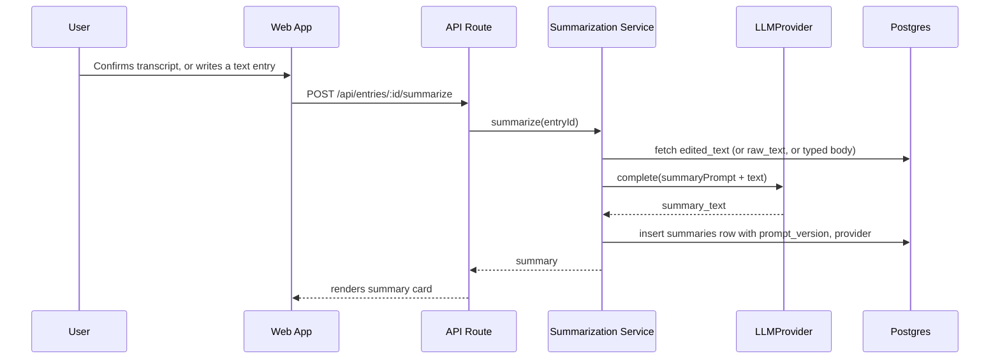

### Folder structure added this phase

```
packages/llm/
├── src/
│   ├── types.ts
│   ├── factory.ts
│   ├── prompts/
│   │   ├── summarize/                  # one versioned template per summary style, not just one
│   │   │   ├── general.prompt.ts
│   │   │   ├── meetings.prompt.ts
│   │   │   ├── interviews.prompt.ts
│   │   │   ├── lectures.prompt.ts
│   │   │   ├── personal.prompt.ts
│   │   │   └── index.ts               # exports a lookup by style name
│   │   └── persona-chat.prompt.ts     # stub for Phase 6
│   ├── providers/
│   │   ├── gemini-provider.ts
│   │   ├── groq-provider.ts
│   │   └── claude-provider.ts         # premium, opt-in
│   └── index.ts
└── package.json

apps/web/
├── app/
│   ├── (protected)/
│   │   ├── journal/page.tsx           # entries where type='journal', filter pills + calendar picker
│   │   ├── notes/page.tsx              # entries where type='note', same filtering
│   │   ├── archive/page.tsx            # entries where archived_at is not null
│   │   ├── trash/page.tsx              # entries where deleted_at is not null, with restore
│   │   └── entries/[id]/page.tsx       # shared detail screen for both journal and note entries
│   └── api/entries/
│       ├── route.ts
│       ├── [id]/summarize/route.ts
│       ├── [id]/archive/route.ts
│       └── [id]/trash/route.ts
└── lib/services/
    └── summarization.service.ts
```

### Task checklist

- [ ] Define `LLMProvider` interface (`complete`, `embed`) in `packages/llm`
- [ ] Implement `GeminiLLMProvider` (default), `GroqLLMProvider` (fast fallback, no embeddings), `ClaudeLLMProvider` (premium, explicit opt-in only)
- [ ] Build `getLLMProvider()` factory switching on `LLM_PROVIDER`
- [ ] Write **five** versioned summary prompt templates (general, meetings & standups, interviews & research, lectures & classes, personal voice notes, matching the use-case options from Phase 3's onboarding), each exporting its own `PROMPT_VERSION` constant, plus a lookup function that resolves a style name to its template
- [ ] Build `summarization.service.ts`: given an entry, fetch confirmed text, look up the calling user's `profiles.summary_style` to pick the right prompt template, call the LLM provider, store the result with `prompt_version` and `provider`
- [ ] Trigger summarization automatically right after a transcript is confirmed (voice path) or a text entry is saved (typed path), same service for both
- [ ] Auto-derive `entries.title` from the first line or sentence of the confirmed transcript/text when no title was explicitly set, matching the note-card behavior in `docs/design-reference/`
- [ ] Build the journal list and notes list screens using the `FilterPills` (All/Today/This week/Date) and `CalendarPicker` components from Phase 2, both querying the same `entries` table filtered by `type`, sharing the same `NoteCard` component
- [ ] Build the shared entry detail screen: transcript (if voice), summary, edit controls
- [ ] Add a "regenerate summary" action for re-running after prompt improvements
- [ ] Add archive and trash (soft delete): `POST /api/entries/[id]/archive` sets `archived_at`, `POST /api/entries/[id]/trash` sets `deleted_at`; build the Archive and Trash list screens with a restore action, and wire the settings-screen Archive/Trash rows (scaffolded as TODOs in Phase 3) to these
- [ ] Add simple text search across entries (title, text, summary) using a basic `ILIKE` query, not a full search stack yet

### Common mistakes

- Calling the LLM synchronously inside the same request that saves the entry, so a slow or failed summary call blocks or risks corrupting the save itself. Save first, always; summarize as a fast follow-up call.
- Not versioning prompts. Months from now you will improve the summary prompt and have no way to know which old summaries used the old one, or safely re-run just those.
- Summarizing raw ASR output instead of the confirmed/edited text. Always summarize what the user confirmed, never the unreviewed transcript.
- Building two separate code paths for "journal" and "notes" because they feel conceptually different. They share an identical pipeline end to end; treat them as one `entries` flow with a `type` field, exactly as designed in Phase 3.
- Hardcoding one summary prompt for every user after all when the product clearly calls for five selectable styles. The style selection happens once at onboarding (Phase 3) and should actually change which prompt template runs, not just be stored and ignored.
- Making trash a hard delete. A soft-delete `deleted_at` column with a restore path is the difference between "oops" being recoverable and being permanent, for an app whose entire content is irreplaceable.

### Best practices

- Keep the LLM provider swap as boring as the ASR one: one factory function, one env var, zero conditionals in business logic.
- Store each `PROMPT_VERSION` as a literal constant exported from its own prompt file.
- Make "regenerate summary" a first-class action from day one; cheap now, expensive to retrofit.
- Default to Gemini 2.5 Flash for quota and cost reasons at MVP stage, but write the Claude adapter now even if unused; Phase 6's past-self chat is the single feature most worth upgrading to a stronger model first.
- Have a real, if simple, empty state for the Archive and Trash screens ("Nothing archived yet"), since most users will see these empty for a long time.

### Claude Code prompt for this phase

```
Continuing in the mindreva monorepo. Build the journaling, notes, and summarization pipeline.

1. Create packages/llm as a new workspace package. Define:
   - types.ts: an LLMProvider interface with complete(messages: {role: 'system'|'user'|'assistant', content: string}[], options?: {maxTokens?: number}): Promise<string> and embed(text: string): Promise<number[]>.
   - providers/gemini-provider.ts: implements LLMProvider using the Gemini API (GEMINI_API_KEY), Gemini 2.5 Flash for completion and Gemini's embedding model for embed().
   - providers/groq-provider.ts: implements LLMProvider using Groq's chat completion endpoint (GROQ_API_KEY). embed() should throw 'not supported'; the factory must never route embedding calls to this provider.
   - providers/claude-provider.ts: implements LLMProvider using the Anthropic API (ANTHROPIC_API_KEY), only ever used when LLM_PROVIDER=claude is explicitly set, never the default.
   - factory.ts: getLLMProvider() reading LLM_PROVIDER from env, defaulting to 'gemini'.
   - prompts/summarize/: five separate prompt files (general, meetings, interviews, lectures, personal), each exporting its own PROMPT_VERSION constant and a template for turning a journal or note entry's confirmed text into a concise summary in that style. Add an index.ts exporting a function that resolves a style name to its template.

2. Build summarization.service.ts in apps/web/lib/services: given an entryId, fetch the confirmed text (edited_text if present, else raw_text, else the typed entry body), look up the entry owner's profiles.summary_style, resolve the matching prompt template, call getLLMProvider().complete(), and store the result in the summaries table with prompt_version and provider. Trigger this automatically right after a transcript is confirmed or a text entry is saved. In this same service, if entries.title is empty, auto-derive it from the first line or sentence of the confirmed text.

3. Build POST /api/entries/[id]/summarize as a manual "regenerate summary" trigger, reusing the same service.

4. Build the journal list screen and notes list screen under apps/web/app/(protected)/journal and .../notes, using the FilterPills and CalendarPicker components from packages/ui, matching docs/design-reference/. Both query the same entries table filtered by type (and excluding archived_at/deleted_at rows), rendered with the NoteCard component.

5. Build a shared entry detail screen at apps/web/app/(protected)/entries/[id]/page.tsx showing the transcript (if voice), the summary, edit controls, and a "Regenerate summary" button.

6. Add archive and trash: POST /api/entries/[id]/archive (sets archived_at) and POST /api/entries/[id]/trash (sets deleted_at, soft delete only, never a hard DELETE). Build apps/web/app/(protected)/archive/page.tsx and .../trash/page.tsx listing entries filtered accordingly, with a restore action on the trash screen. Wire these into the account/settings screen's Archive and Trash rows that were scaffolded as TODOs in Phase 3.

7. Add simple text search across entries (title, edited_text, summary_text) using a basic ILIKE query; do not build full-text search infrastructure yet.

Keep journals and notes as one entries flow distinguished only by the type field. Do not build two parallel systems.
```

---

## Phase 6: "Chat with Past Self" (RAG Persona Engine)

**Objective:** the differentiated feature. Turn stored journal entries into a queryable, grounded persona, scoped to a date range, that never invents what the user didn't actually write.

**Priority:** P1 (this is your flagship feature, but it depends on Phases 3-5 being solid first)
**Estimated time:** 5-7 days
**Dependencies:** Phase 5

### Architecture diagram

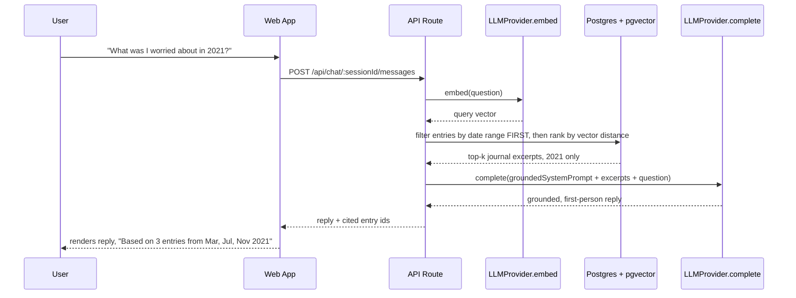

### The grounding prompt (this is the actual safeguard, not decoration)

```
You are simulating a reflective conversation with the user's own past self,
based ONLY on journal entries they actually wrote between {startDate} and {endDate}.

Rules:
1. Only reference facts, feelings, or events that appear in the excerpts below.
   Never invent details, people, or events not present in the excerpts.
2. If the question asks about something not covered in the excerpts, say plainly:
   "I don't have a journal entry from this period about that."
3. Speak in first person, grounded in the tone and words actually used in the excerpts.
4. Never diagnose or make clinical claims about the user's mental state.
   Reflect only what they wrote.
5. Never offer therapy-style advice. This is a reflective exercise, not counseling.

Journal excerpts from {startDate} to {endDate}:
{excerpts}

User's question: {question}
```

### Visual direction (no reference screen exists for this one, this is the intended feel)

This screen should not read as a generic chatbot. A few deliberate departures from the rest of the app, all still using the same dark mint / white / serif-plus-sans design system from Phase 2, not a new palette:

- **A clear "you're talking to a specific period" header**, not just a chat title: the year or date range front and center (e.g. "2021" large, in the serif logo typeface, with the exact date range in small text underneath), so it always reads like opening a specific chapter, not starting a new conversation.
- **Distinguish the two voices visually without resorting to a typical left/right bubble color-swap.** The user's own messages can stay plain and simple. The "past self" replies are the one place in the whole app where the serif font (otherwise reserved for the logo) reappears, for the reply text itself; it's a small, cheap touch that makes the past self's words feel distinct from ordinary UI chrome.
- **Make the citation trace a real, tappable element, not a caption.** Render "Based on 3 entries from Mar, Jul, Nov 2021" as small pill-shaped chips, one per cited entry, that jump to that entry's detail screen when tapped. This is the trust mechanism from ADR/Phase 6 made physically visible, treat it as a core piece of the UI, not a footnote.
- **The empty state matters more here than anywhere else in the app.** Starting a session for a period with zero entries, or very few, should say so warmly and plainly before the user even sends a message ("There are only 2 entries from 2019, so I might not have much to go on yet"), not silently let them ask into a void.

### Folder structure added this phase

```
packages/llm/src/prompts/
└── persona-chat.prompt.ts        # implemented now, was a stub since Phase 5

packages/database/src/repositories/
└── embeddings.repository.ts      # gains matchEntries(userId, vector, dateRange, limit)

apps/web/
├── app/
│   ├── (protected)/chat/
│   │   ├── page.tsx               # list past sessions, start a new one
│   │   └── [sessionId]/page.tsx    # the chat UI itself
│   └── api/chat/
│       ├── sessions/route.ts
│       └── [sessionId]/messages/route.ts
└── lib/services/
    └── persona-chat.service.ts
```

### Task checklist

- [ ] Extend the pipeline: right after a summary is generated (Phase 5), embed the entry (title + edited_text, one chunk per entry for MVP, no chunking logic needed yet) via `LLMProvider.embed()` and store it in `embeddings`
- [ ] Add `matchEntries(userId, queryVector, dateRangeStart, dateRangeEnd, limit)` to `embeddings.repository.ts`: filter by user and date range **first**, then rank by vector distance, return top-k with entry id, text, and entry_date
- [ ] Build the "start a chat with past self" screen: pick a year or custom range, create a `chat_sessions` row
- [ ] Write the grounded persona prompt above as a versioned template, same pattern as the summary prompt
- [ ] Build `persona-chat.service.ts`: embed the question, retrieve top-k entries scoped to the session's range, build the prompt with excerpts, call `LLMProvider.complete()`, store both messages in `chat_messages` including which entry ids were actually cited
- [ ] Build the chat UI following the "Visual direction" above: a prominent year/date-range header in the serif logo typeface, "past self" replies also set in serif (the one other place in the app that font appears), and the citation trace rendered as tappable pill chips linking to source entries, not a caption
- [ ] Handle the "no entries in this period" case explicitly, both before the first message (UI warning) and gracefully mid-conversation
- [ ] Write a small manual eval set: 5-10 sample questions against test journal fixtures, checking the model never states a fact absent from the fixtures (manual review is fine, no automation needed at MVP stage)
- [ ] Add a simple per-session message cap so one conversation can't consume unbounded LLM quota

### Common mistakes

- Letting retrieval rely on semantic similarity alone. A question about "2021" can still semantically match a similar-sounding 2023 entry. Always hard-filter by date range before ranking by similarity; this is the single most important guardrail in this phase.
- No visible grounding or citation in the UI. Without showing which entries a reply drew from, there's no way for the user to verify a response, and no way for you to debug a bad one.
- Writing a persona prompt that lets the model "elaborate in the spirit of" the user's past writing. For a feature this emotionally sensitive, invented detail is a trust-destroying failure, not a charming flourish. Constrain the model explicitly to only what's in the excerpts.
- Skipping an explicit "I don't have a record of that" instruction. Silence or a fabricated answer are both worse than an honest "no entry found for this period."
- No cap on messages per session. A free LLM tier disappears fast if one conversation can run unbounded turns.

### Best practices

- Reuse the exact same `LLMProvider` interface from Phase 5. This feature needs zero new provider plumbing, only a new prompt and a new retrieval query.
- Treat the persona prompt as a first-class, versioned artifact, exactly like the summary prompt, since tone and grounding rules will need iteration.
- Surface citations by default, not as an optional toggle. Trust is the entire value proposition of this feature.
- Keep the retrieval query inside the repository layer, so the date-range hard filter lives in one tested place, not re-implemented ad hoc in a route handler.

### Claude Code prompt for this phase

```
Continuing in the mindreva monorepo. Build the "chat with past self" feature.

1. Extend the summarization pipeline (from Phase 5): right after a summary is generated for an entry, call getLLMProvider().embed() on the entry's title + edited_text (or summary_text if more concise) and store the resulting vector in the embeddings table, one row per entry for now, no chunking yet.

2. In packages/database/src/repositories/embeddings.repository.ts, add matchEntries(userId, queryVector, dateRangeStart, dateRangeEnd, limit): filter entries to the given user and date range FIRST (via a join on entries.entry_date), THEN order by vector distance to queryVector, returning the top `limit` results with entry id, text, and entry_date.

3. In packages/llm/src/prompts/persona-chat.prompt.ts, write a versioned system prompt template instructing the model to: only use facts present in the provided journal excerpts, explicitly say "I don't have a journal entry from this period about that" when the question isn't covered, respond in first person as the user's own past self, never diagnose or make clinical claims about the user's mental state, and never offer therapy-style advice.

4. Build persona-chat.service.ts in apps/web/lib/services: given a chat session (with persona_year_start/persona_year_end) and a new user message, embed the message, call matchEntries scoped to that date range, build the grounded prompt with retrieved excerpts, call getLLMProvider().complete(), and store both the user message and the assistant reply in chat_messages, with cited_entry_ids populated from the entries actually used.

5. Build the chat UI: a screen to start a new persona session by picking a year or custom date range (creating a chat_sessions row), and a chat screen sending messages to POST /api/chat/[sessionId]/messages. There is no reference screenshot for this one, so follow this direction specifically: show the year/date range prominently at the top in the serif logo typeface (not the sans body font used everywhere else), render "past self" reply text in that same serif font as the one other deliberate use of it in the app, and render the citation trace as tappable pill-shaped chips ("Based on 3 entries from Mar, Jul, Nov 2021") that navigate to the cited entry's detail screen when tapped, not a plain caption line.

6. Handle the empty-retrieval case explicitly: if no entries exist in the selected range, the UI should say so before the user sends a message, and the service should respond gracefully if it happens mid-conversation.

7. Add a simple per-session message cap (a config constant) to bound LLM usage per conversation.

The date-range hard filter in matchEntries must run before, not instead of, the vector similarity ranking. This is a hard requirement.
```

---

## Phase 6.5: Photo Attachments for Entries

**Objective:** let a user attach one or more photos to a journal entry or note, either right after recording (on the transcript review screen) or later from the entry detail screen, with the same RLS guarantees as every other piece of entry data.

**Priority:** P2 (a nice-to-have enrichment, not a blocker for any later phase)
**Estimated time:** 1-2 days
**Dependencies:** Phase 5 (entries, transcript review, and entry detail screens must already exist)

This was an unplanned addition, not called for in the original roadmap — added mid-build per a direct request, after Phase 6 shipped. See `docs/DECISIONS.md` if a decision worth recording came out of it.

### Folder structure added this phase

```
packages/database/
├── migrations/
│   ├── 0004_*.sql                          # entry_photos table DDL (drizzle-kit generate)
│   └── 0005_entry_photos_rls_and_bucket.sql # RLS policy + "photos" Storage bucket + Data API grant (hand-authored)
└── src/repositories/
    └── entry-photos.repository.ts          # create, listByEntry, getFirstPhotosForEntries, getFirstPhotosByDate

packages/ui/src/components/
├── note-card.tsx                # redesigned: leading date badge, bold title, snippet, trailing cover thumbnail
├── calendar-picker.tsx           # redesigned: custom DayButton renders each day's cover photo as its background
└── photo-uploader.tsx           # redesigned: large hero photo + thumbnail strip + add tile, presentation-only

apps/web/
├── app/
│   ├── api/entries/[entryId]/photos/route.ts   # POST: upload + create entry_photos row
│   └── (protected)/
│       ├── _components/entry-list-screen.tsx    # passes thumbnailUrl / dayThumbnails through to NoteCard / CalendarPicker
│       └── entries/[entryId]/
│           ├── review/transcript-review.tsx      # PhotoUploader wired in (attach right after recording)
│           └── entry-detail.tsx                  # reordered: date, headline, hero photo, body, then summary card
└── lib/services/
    └── entries.service.ts       # addPhotoToEntry, signPhotoUrls, getMyEntryDetail/listMyEntries/listMyDayThumbnails
```

### Task checklist

- [x] Add `entry_photos` table to `packages/database/src/schema.ts`: `id` (uuid PK), `entry_id` (FK -> `entries.id`, cascade delete), `storage_path` (text), `position` (integer, default 0), `created_at`
- [x] Generate the table migration with `drizzle-kit generate`, then hand-author a second migration for RLS (join through `entries` on `user_id`, same pattern as `recordings`), the Data API grant, and the `photos` Storage bucket + its three per-user-folder policies (select/insert/delete)
- [x] Apply both migrations to the live Supabase project and verify RLS is enabled, the bucket exists and is private, and the table starts empty
- [x] Build `EntryPhotosRepository` with `create` (asserts the entry belongs to the caller, computes `position` server-side as the current photo count) and `listByEntry` (ordered by `position`)
- [x] Add `addPhotoToEntry` to `entries.service.ts`: uploads to the `photos` bucket via the session-scoped Supabase client (same RLS defense-in-depth as `createVoiceEntry`), then creates the `entry_photos` row
- [x] Add signed-URL generation for display — a batch `createSignedUrls` call for `getMyEntryDetail` (avoids N round trips), a single `createSignedUrl` call for a fresh upload
- [x] Update `getMyEntryDetail` to also return the entry's ordered photos (`{id, url}[]`) alongside the existing transcript/summary
- [x] Add `POST /api/entries/[entryId]/photos` (multipart form, one file per request)
- [x] Verify live end-to-end against the real Supabase project: user A can upload a photo, insert its `entry_photos` row, and resolve a signed URL for it; user B cannot read the row, list it, download the object, sign a URL for it, or insert a row against user A's entry

**Redesign pass** (same phase, after the reference screenshots `docs/design-reference/new-journal-list.png`, `new-date-picker.png`, and `new-journal-overview-page.png` were provided — the initial cut above bolted the upload control onto the pre-existing layouts rather than matching these):

- [x] Add `EntryPhotosRepository.getFirstPhotosForEntries` (batched, `DISTINCT ON` per entry id) and `getFirstPhotosByDate` (batched, `DISTINCT ON` per `entry_date`) so list rows and calendar cells can each resolve their cover photo in one query, not N
- [x] Add `listMyDayThumbnails` and thumbnail-attachment to `listMyEntries` / `listMyArchivedEntries` / `listMyTrashedEntries` / `searchMyEntries` in `entries.service.ts`, batch-signing all cover-photo URLs for a screen in a single Storage call
- [x] Redesign `NoteCard`: a leading date badge (weekday over day-of-month, our accent-mint token, not a plain text line), bold single-line title, two-line snippet, and a trailing square cover-photo thumbnail — omitted entirely (not a blank gray box) when the entry has no photo
- [x] Redesign `CalendarPicker`: a custom `DayButton` renders that date's cover photo as the cell's background image when one exists; days without a photo stay a plain `bg-warm-100` neutral cell; the "has an entry, no photo" dot only shows when there's no thumbnail to avoid stacking; selected/today styling uses `bg-primary`/`ring-primary` (dark mint), not the reference's blue; Clear/Today actions and the tap-to-select interaction are unchanged
- [x] Reorder `entry-detail.tsx` to the reference's hierarchy: date, then a bold headline pulled from the entry's title, then the (now hero-sized) `PhotoUploader`, then the body/transcript text, then the existing Summary card below — the summary card was kept, not removed, this app has AI summaries and the reference app doesn't
- [x] Rebuild `PhotoUploader`: the first photo now renders as a large `aspect-[4/3]` hero (or an inviting dashed-border empty state prompting "Add a photo" when there isn't one yet), with any additional photos plus the "add another" tile in a small thumbnail strip underneath — replacing the old flat row-of-equal-thumbnails layout
- [x] Re-verify `pnpm lint` and `pnpm build` pass with the redesigned components in place

**Fix pass** (same phase, after a follow-up review against the reference images found the first redesign pass close but not exact):

- [x] Fix `NoteCard`'s date badge not rendering: rebuilt it as a plain round badge (white circle on the card's mint fill, weekday small on top / day-of-month large below) instead of the previous pale-mint-badge-on-white-card combination, which was visually near-invisible against the card background — the data was always there, the contrast wasn't
- [x] Give every `NoteCard` a fixed height (`h-24`) regardless of whether it has a cover photo, so list rows are uniformly sized exactly as in `new-journal-list.png`, instead of the previous auto-height row that shrank for photo-less entries
- [x] Increase list spacing from `space-y-3` to `space-y-4` across the journal/notes list, Archive, and Trash screens — cards were reading as too tight together
- [x] Rework `entry-detail.tsx` into one seamless page matching `new-journal-overview-page.png`: removed the bordered `Textarea` box and the `Card`-wrapped Summary section entirely; content now flows top to bottom as plain page content — title, then summary text, then the photo, then the transcript (still a real, editable `Textarea`, but restyled with no border/background/shadow so it reads as flowing body text, not a boxed form field) — instead of the previous layout's visually separated, individually-bordered blocks
- [x] Re-verify `pnpm lint` and `pnpm build` pass with the fix pass in place

### Common mistakes

- Trusting a client-supplied `position` for ordering. A malicious or buggy client could then desync the display order or collide positions across concurrent uploads; compute it server-side from the current count instead.
- Generating signed URLs one at a time for a list of photos, or one at a time per list row. Batch it: one `createSignedUrls` call for all of a list screen's cover photos (or the calendar's day thumbnails), not N Storage round trips.
- Forgetting the Data API grant on the new table. This project has "automatically expose new tables" off, so a table with RLS enabled but no `GRANT ... TO authenticated` fails silently from the client with a permissions error that looks like an RLS bug but isn't one.
- Using `next/image` for these thumbnails. The `url` is a short-lived, per-request signed URL for a private object, not a stable remote domain `next/image` can allowlist and optimize; a plain `` is the right call here, same reasoning as everywhere else this app touches private Storage objects.
- Adding an `eslint-disable-next-line` comment for a rule from a plugin the local package's ESLint config doesn't load (e.g. `@next/next/no-img-element` inside `packages/ui`). That's a hard "Definition for rule not found" error, not a no-op — and moot anyway, since `apps/web`'s Next-specific lint rules never scan `packages/ui`'s source in the first place.
- Copying a design reference's exact palette or chrome instead of its layout. `new-journal-list.png` et al. are structure references (proportions, information hierarchy, grid density) — colors stay dark mint, and app-specific chrome the reference happens to have (a photo hero banner, Media/Map tabs) doesn't get added just because the screenshot has it.
- Building a calendar day-cell photo treatment as a separate `` layered under the button. `react-day-picker` v9's `components.DayButton` override lets the thumbnail be the button's own `background-image`, which keeps hit-testing, focus, and the existing modifier classes (`selected`, `today`, `outside`) all working unmodified.
- Low-contrast badges: a pale tint-on-tint combination (light mint text/fill on a light card) can pass code review and even render correctly in the DOM while being effectively invisible to the eye. When a reference shows a small badge or label, check it against the actual background it sits on, not just that the markup exists.
- Variable-height list rows when the reference shows uniform ones. A trailing thumbnail that only sometimes renders will silently shrink the row for entries without one, unless the row's height is set explicitly rather than left to content.
- "Editable as rich text" doesn't automatically mean pull in a WYSIWYG editor library. Confirm scope before adding a dependency — here it meant "no visible box/border around the editable text, so it reads as body copy," not actual bold/italic/list formatting; the existing plain-text `Textarea` covers that once restyled.
- Leaving a `Card`/bordered wrapper around a section after the user asked for a "seamless" page. Removing the divider means removing the surface too (background, border, shadow, padding-as-box) — restyling only the border and leaving the distinct background/shadow still reads as a separate block.

### Best practices

- Mirror the existing `recordings`/`recordings` bucket pattern exactly rather than inventing a new shape for `entry_photos`/`photos` — same join-through-`entries` RLS policy, same per-user-folder Storage path convention, same two-migration split (auto-generated table DDL, then hand-authored RLS/bucket).
- Keep `PhotoUploader` presentation-only. It never calls `fetch` itself; both places it's used (`transcript-review.tsx`, `entry-detail.tsx`) own their own upload logic and pass it down as a callback.
- Verify RLS live against the real database, not just via a clean migration exit code — a throwaway two-user script proving cross-user reads/writes/downloads/signed-URLs all fail is worth the few minutes it takes, for a feature this trust-sensitive.
- When a redesign is requested against reference screenshots, treat "layout, not palette" literally: reuse the app's own tokens (`bg-primary`, `bg-accent`, `shadow-subtle`, `rounded-lg`) for every surface the reference draws in its own colors, and skip any reference-specific chrome (hero banners, extra tabs) that doesn't correspond to a feature this app actually has.

---

## Phase 7: CI/CD & Free-Tier Deployment

**Objective:** automated checks on every PR, safe preview deployments, a live production app on Vercel Hobby, and just enough observability to know when something breaks.

**Priority:** P0
**Estimated time:** 2-3 days
**Dependencies:** Phase 2 (styling exists to deploy something visible); can otherwise run in parallel with Phases 3-6

### Architecture diagram

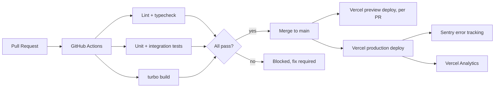

### Folder structure added this phase

```
.github/workflows/
└── ci.yml
DEPLOYMENT.md
```

### Task checklist

- [ ] Write `.github/workflows/ci.yml`: on every PR, run install, lint, typecheck, test, and build via Turborepo, in that order, failing fast
- [ ] Cache the pnpm store and Turborepo remote cache between CI runs to keep pipeline time low
- [ ] Confirm Vercel's automatic PR preview deployments are enabled (should already work from the Phase 1 connection)
- [ ] Set environment variables separately for Preview and Production in the Vercel dashboard; **never point Preview at the same Supabase project as Production** once real user data exists
- [ ] Add branch protection on `main`: require the CI workflow to pass before merge
- [ ] Set up Sentry (free tier) for client and server error tracking
- [ ] Enable Vercel Analytics (free tier) for basic traffic visibility
- [ ] Write `DEPLOYMENT.md`: every env var and what it's for, how to rotate keys, how to roll back a deployment, a manual smoke-test checklist
- [ ] Run the full manual smoke test against the live production URL: sign up, record, transcribe, summarize, start a past-self chat
- [ ] Explicitly revisit ADR-7: confirm you're still within Vercel Hobby's non-commercial terms, and note the calendar date you plan to introduce monetization so the Pro upgrade isn't a surprise later

### Common mistakes

- Pointing Preview deployments at the same Supabase project as Production. A migration tested in preview can silently corrupt or break production data, or preview traffic can pollute real user rows.
- No branch protection, so a broken `main` reaches production directly.
- Treating error tracking and analytics as "later" polish. The first time something breaks in production without either, you are debugging blind with real users affected.
- Forgetting ADR-7's non-commercial restriction and quietly starting to charge users while still on Hobby.

### Best practices

- Keep CI fast (a few minutes). Slow CI gets skipped or ignored over time, which defeats its purpose.
- Use the Vercel preview URL per PR as your actual QA environment, not just local dev; it's the closest thing to production you have for free.
- Write `DEPLOYMENT.md` now, while you remember why each env var exists, not after you've forgotten.
- Treat the Vercel Pro upgrade as a calendar decision tied to your monetization plan, not a reactive one tied to hitting a usage wall.

### Claude Code prompt for this phase

```
Continuing in the mindreva monorepo. Set up CI/CD.

1. Write .github/workflows/ci.yml: triggered on pull requests to main, running in order (failing fast): pnpm install, turbo lint, turbo typecheck (or tsc --noEmit across all packages), turbo test, turbo build. Cache the pnpm store and the Turborepo cache between runs.

2. Write DEPLOYMENT.md at the repo root documenting: every environment variable from .env.example and what it's for, how to rotate the Supabase service role key, how to roll back a Vercel deployment, and a step-by-step production smoke test checklist (sign up, record a voice entry, confirm the transcript, view the generated summary, start a past-self chat session).

3. Add a Sentry integration to apps/web for both client and server error boundaries, reading a SENTRY_DSN environment variable, with a clear TODO comment marking it as needing a real DSN before it becomes active.

Don't touch Vercel project settings or environment variables directly; just prepare the repo-side configuration and documentation. I'll wire up the actual Vercel dashboard settings myself.
```

---

## Phase 8: PWA + Capacitor Mobile Wrapper -> Play Store

**Objective:** wrap the existing Next.js web app in Capacitor with zero rewrites, bridge in native audio recording, and get through Google Play's actual submission process, which now includes a mandatory testing gate for new developer accounts that you need to plan calendar time around.

**Priority:** P1
**Estimated time:** 5-8 days of engineering work, but budget 3-4 additional calendar weeks end-to-end because of Google's mandatory closed-testing period (details below), which runs in parallel with other work but cannot be compressed
**Dependencies:** Phase 7

### Architecture diagram

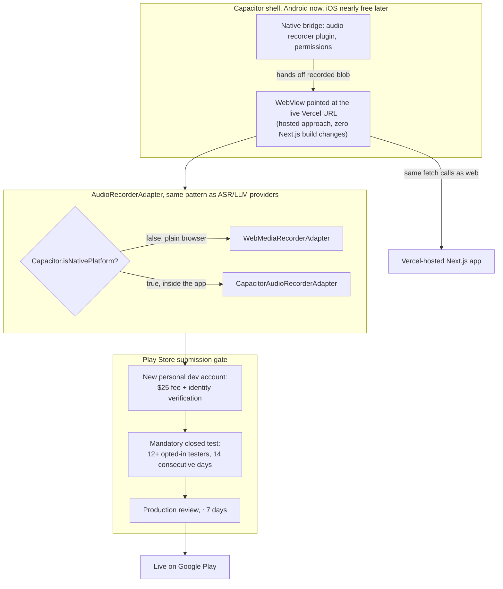

### Folder structure added this phase

```
apps/web/
├── capacitor.config.ts            # server.url points at the live production URL
├── android/                        # generated by the Capacitor CLI
└── lib/recording/
    ├── audio-recorder-adapter.ts  # interface, same pattern as ASRProvider
    ├── web-recorder-adapter.ts     # wraps existing MediaRecorder logic from Phase 4
    └── capacitor-recorder-adapter.ts
```

### Task checklist

- [ ] Add a web app manifest and a minimal service worker to `apps/web` for PWA installability (near-free given the design system already exists)
- [ ] Install Capacitor, configure `capacitor.config.ts` with `server.url` pointing at the live production Vercel URL (the "hosted" approach: no static export, no changes to any existing Next.js server feature)
- [ ] Add the Android platform, confirm it builds and runs in Android Studio
- [ ] Define an `AudioRecorderAdapter` interface, implement `WebMediaRecorderAdapter` (wraps the Phase 4 browser logic) and `CapacitorAudioRecorderAdapter` (wraps a real native plugin such as `@capgo/capacitor-audio-recorder` or the Capawesome audio recorder plugin), select via `Capacitor.isNativePlatform()`
- [ ] Add Android manifest permissions: microphone access, plus `FOREGROUND_SERVICE`, `FOREGROUND_SERVICE_MICROPHONE`, and `WAKE_LOCK` if background recording matters to you
- [ ] Add `NSMicrophoneUsageDescription` to iOS `Info.plist` too, since Capacitor makes iOS nearly free once Android works, even if Play Store is the immediate target
- [ ] Test the full record -> upload -> transcribe -> summarize flow on a real Android device, not only the emulator
- [ ] Write a privacy policy (mandatory for a microphone-permission app) and host it at a public URL
- [ ] Complete the Play Console "Data safety" declaration honestly: this app collects audio recordings and personal journal text, potentially revealing emotionally sensitive information; disclose accordingly
- [ ] Register a Google Play developer account ($25 one-time fee), complete identity verification
- [ ] Build against the current required target API level. **Note the deadline: Google requires apps to target Android 16 (API level 36) starting August 31, 2026,** which is close to when you'll likely be submitting; verify the current requirement in Play Console before building your release
- [ ] **Plan for the mandatory closed-testing gate.** Any personal Google Play developer account created after November 13, 2023 (yours will be) must run a closed test with at least 12 real opted-in testers for 14 consecutive days before you can even apply for production access. Recruit testers early, in parallel with the engineering work above, not after the build is done. Organization accounts are exempt from this gate if you register as one instead
- [ ] Prepare store listing assets: icon, feature graphic, screenshots, short and full description
- [ ] Apply for production access once the closed test completes, then submit for review (commonly around 7 days, sometimes longer)

### Common mistakes

- Assuming you can submit to production the day the build works. The 12-tester, 14-day closed testing gate for new personal developer accounts is a hard calendar requirement, not a suggestion; discovering it the week you meant to launch costs you weeks you didn't plan for.
- Relying on the browser `MediaRecorder` API unchanged inside the Capacitor WebView and assuming permission handling behaves identically to a normal browser tab. It doesn't always. Use a real native audio recording plugin for the packaged app.
- Leaving the privacy policy and Data Safety declaration until submission day. For an app recording personal audio and storing journal content, Google reviews permission-sensitive apps carefully; get these right, and get them right early.
- Building against a target API level below the current requirement (rising to API 36 on August 31, 2026) and getting rejected on a technicality unrelated to the app itself.
- Statically exporting the Next.js app before you actually need to. The hosted-WebView approach needs zero changes to your existing app and is the right MVP choice; only move to a bundled static export later if genuine offline support becomes a real requirement.

### Best practices

- Ship the PWA manifest first. It's nearly free given the design system already exists, and gives you an installable home-screen icon on both Android and iOS before writing a line of Capacitor code.
- Keep `AudioRecorderAdapter` as clean as the ASR/LLM provider pattern used everywhere else in this roadmap: it's the same idea (interface plus a runtime-selected implementation) applied to a device capability instead of an API.
- Start the Play Console account, identity verification, and tester recruitment in parallel with the Capacitor build, not after. Verification and the closed-testing clock are the slowest parts of this phase, not the code.
- Treat the Data Safety form as a trust document, not paperwork. Users are trusting this app with their private thoughts; disclosing data handling honestly is part of the product, not a compliance checkbox.

### Claude Code prompt for this phase

```
Continuing in the mindreva monorepo. Wrap apps/web for mobile and prepare it for Android.

1. Add a web app manifest and a minimal service worker to apps/web for PWA installability (icon, name, theme color from the mint palette in packages/ui).

2. Install Capacitor in apps/web. Configure capacitor.config.ts so server.url points at the production Vercel URL (read from an environment variable, don't hardcode it), so the WebView loads the live hosted app rather than a static export. Add the Android platform via the Capacitor CLI.

3. Define an AudioRecorderAdapter interface in apps/web/lib/recording/audio-recorder-adapter.ts with start(), pause(), resume(), stop(): Promise<{blob: Blob, durationMs: number}>, and requestPermission(): Promise<boolean>.

4. Implement WebMediaRecorderAdapter wrapping the existing browser MediaRecorder logic from Phase 4, and CapacitorAudioRecorderAdapter wrapping a native Capacitor audio recording plugin. Write a small factory that checks Capacitor.isNativePlatform() and returns the correct adapter. Update the recording screen to use this factory instead of calling MediaRecorder directly.

5. Add the necessary Android manifest permissions for microphone access (and foreground service permissions if background recording matters), and add NSMicrophoneUsageDescription to the iOS Info.plist too, even though Android/Play Store is the immediate target.

6. Do not statically export the Next.js app. Keep all existing API routes and server features exactly as they are; the Capacitor WebView should simply load the live production URL.

After this is done, I will handle the Android Studio build, Play Console account setup, identity verification, recruiting closed-test testers, and the store listing myself, since those are account and business-process steps outside the codebase.
```

---

## Phase 9: Scaling, Observability & Migration Playbook

**Objective:** know your free-tier ceilings before you hit them, have a pre-written migration path for every provider, and make sure the one truly irreplaceable thing in this app (years of someone's journal) is never at risk of silent loss.

**Priority:** P2 (not urgent for MVP, but the backup and export pieces should not be delayed indefinitely)
**Estimated time:** 1-2 days of setup, then an ongoing weekly habit
**Dependencies:** Phase 7

### Architecture diagram

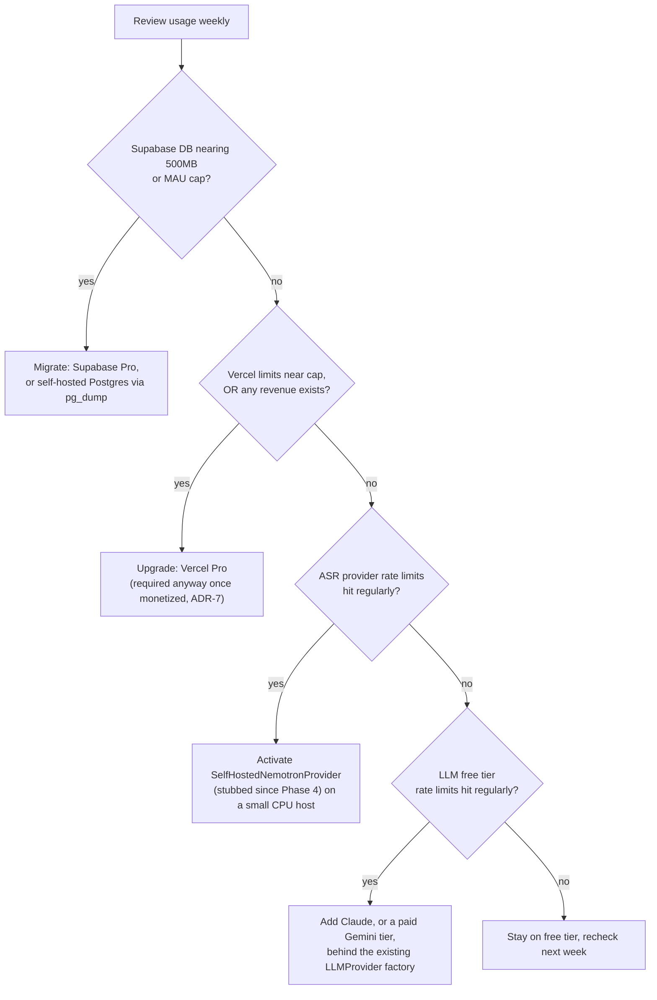

### Task checklist

- [ ] Set up a simple weekly usage review across the Supabase dashboard (DB size, MAU), Vercel dashboard (bandwidth, function invocations, active CPU time), and your ASR/LLM provider dashboards
- [ ] Turn on usage alerts wherever the provider supports them, so you see a cliff coming instead of discovering it via a 429 error in front of a real user
- [ ] Write the migration steps for each provider as literal instructions, not "figure it out later": Supabase free to Pro, Vercel Hobby to Pro, hosted ASR to self-hosted Nemotron, Gemini free to paid or Claude
- [ ] Implement automated database backups. Supabase's free tier does not include managed backups, so schedule your own (a GitHub Actions cron job running `pg_dump`, uploaded to a free object store such as Cloudflare R2)
- [ ] Build and test a real "download my journal" export feature (JSON, and ideally a readable Markdown export too), scoped strictly to the requesting user's own data through the existing repository layer. For an app whose entire value is irreplaceable personal history, this is a trust feature, not a nice-to-have
- [ ] If usage now justifies it, implement `SelfHostedNemotronProvider` for real: start with the benchmarked English ONNX build if most users are English speakers, or the community multilingual ONNX/CoreML build if you need global coverage (load-test thoroughly first, this path is newer)
- [ ] Write a rollback plan for every migration: how to revert if a new provider misbehaves
- [ ] Revisit ADR-7 one last time: if you have paying users and haven't moved off Vercel Hobby yet, do it this phase

### Common mistakes

- Waiting until a free-tier cap is hit in production, with real users, before thinking about migration for the first time. Write the playbook before you need it, not during an outage.
- Assuming "Supabase handles backups." The free tier does not include managed backups; treat this as your responsibility.
- Skipping a user-facing data export. If Mindreva ever pivots, or a user simply wants their own words back, an app whose entire value proposition is a person's private history carries an unusually high obligation to make that data portable.
- Cutting over to self-hosted ASR under production load with no fallback. Keep the hosted provider (Groq/Hugging Face) configured and selectable even after self-hosting becomes the default, so a self-hosted outage doesn't take transcription down entirely.

### Best practices

- Because every provider in this roadmap sits behind an interface (`ASRProvider`, `LLMProvider`), every migration in this phase is a configuration change plus a new adapter file, never a rewrite of business logic. This is the actual payoff of the architecture built across Phases 3-6.
- Build the data export feature before you need it for a support request, not in response to one.
- Keep both a hosted and a self-hosted ASR adapter configured simultaneously once you reach this stage; consider routing a small slice of traffic to whichever one you're validating rather than a hard cutover.
- Revisit this entire document quarterly. Free tier limits, model releases (including how mature the multilingual Nemotron CPU story has become by then), and Play Store policies all move fast. This roadmap is a snapshot of July 2026, not a permanent contract.

### Claude Code prompt for this phase

```
Continuing in the mindreva monorepo. Prepare the scaling and migration tooling.

1. Add a GitHub Actions scheduled workflow that runs pg_dump against the Supabase database and uploads the result to a Cloudflare R2 bucket (or another free object store), running weekly, since Supabase's free tier does not include managed backups.

2. Build a "Download my journal" feature: a route handler and a UI action that export all of a user's entries, transcripts, and summaries as a single downloadable JSON file (and optionally a human-readable Markdown export), scoped strictly to the requesting user's own data through the existing repository layer.

3. Implement the real SelfHostedNemotronProvider in packages/asr/src/providers/self-hosted-provider.ts (a stub since Phase 4): it should call a small standalone inference service (run separately, e.g., on a lightweight CPU VM) wrapping NVIDIA's Nemotron 3.5 ASR via its ONNX Runtime export, matching the exact same ASRProvider interface as the other adapters. Add a README in apps/inference (create this app if it doesn't exist) explaining how to run the inference service, noting that the English-only ONNX build has a benchmarked CPU performance profile, while the multilingual ONNX build is newer and should be load-tested before being made the default.

4. Keep GroqASRProvider fully configured and selectable via ASR_PROVIDER even after the self-hosted option exists, so there is always a working fallback if the self-hosted service has an outage.

Do not change the ASRProvider interface itself. The new implementation must be a drop-in replacement selected only via the ASR_PROVIDER environment variable, exactly like every other provider in this codebase.
```

---

## Appendix A: Free-Tier Reference

Verified as of July 2026. Free tiers change frequently; recheck the provider's own docs before making a business decision based on any single number here.

| Service                       | What's free                                                                                                                                          | The catch                                                                                                                                                        |
| ----------------------------- | ---------------------------------------------------------------------------------------------------------------------------------------------------- | ---------------------------------------------------------------------------------------------------------------------------------------------------------------- |
| Vercel Hobby                  | ~100GB bandwidth, ~100K-1M function invocations, ~6,000 build minutes, ~4 hours active CPU                                                           | Personal/non-commercial use only per ToS; function timeout commonly cited around 10 seconds (verify current docs); design async for anything that might run long |
| Supabase Free                 | 500MB database, 1GB file storage, 50,000 MAU, ~5GB egress, pgvector included, 2 active projects                                                      | Projects pause after 7 days of inactivity (set up a keep-alive ping); no managed backups                                                                         |
| Hugging Face Inference API    | Rate-limited access to thousands of models, no published fixed numbers                                                                               | Fine for prototyping, not for sustained production volume; Inference Endpoints ($0.03/hr+ CPU) are the pay-as-you-go upgrade                                     |
| Groq                          | Fast (LPU hardware) chat completion and hosted Whisper transcription, no credit card required                                                        | Rate limits vary by model (roughly tens of requests/minute, low thousands of requests/day); open-source models only, no GPT/Claude/Gemini                        |
| Google Gemini API             | Most generous permanent free tier among frontier-adjacent models; Gemini 2.5 Flash around 1,000-1,500 requests/day; explicitly allows commercial use | No SLA, deprioritized under peak load; Gemini 2.5 Pro is far more limited than Flash on the free tier                                                            |
| Anthropic Claude API          | No standing free tier                                                                                                                                | Occasional expiring trial credits for new accounts only; budget for pay-per-token once you add Claude as a provider                                              |
| GitHub Actions                | Generous free minutes for both public and private repos at this scale                                                                                | N/A at MVP scale                                                                                                                                                 |
| Google Play developer account | N/A, $25 one-time fee                                                                                                                                | New personal accounts (post Nov 13, 2023) must complete a 12-tester, 14-day closed test before production access; organization accounts are exempt               |

---

This document is a snapshot, not a contract. Free tier numbers, model releases, and store policies move fast; treat every specific figure above as something to reverify the month you act on it, not something to build a business plan around permanently.
